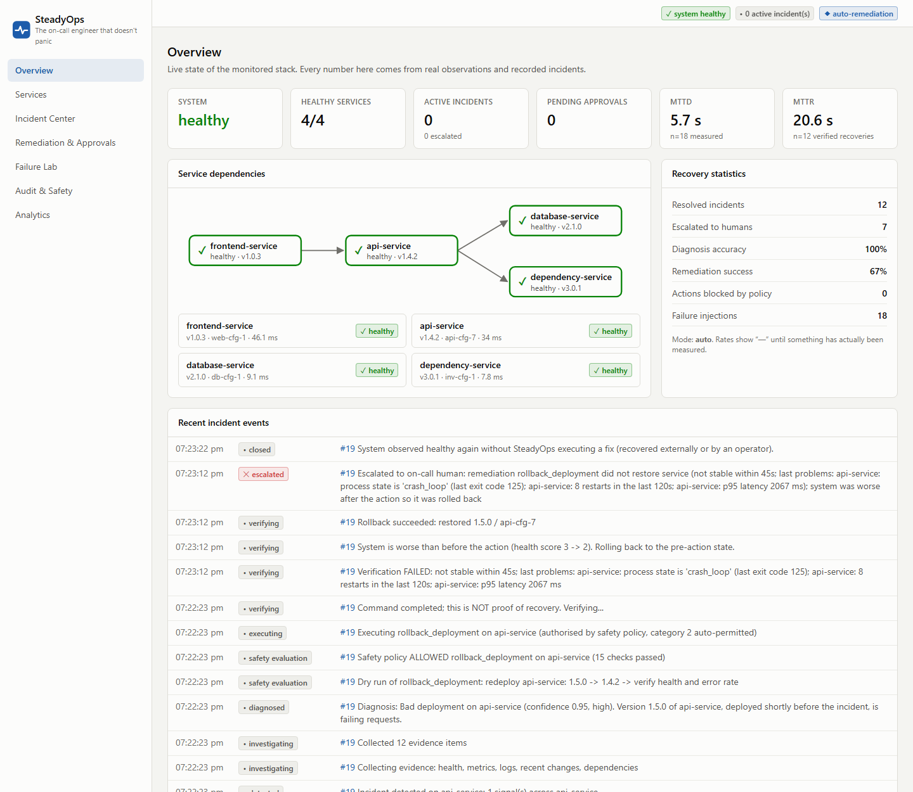
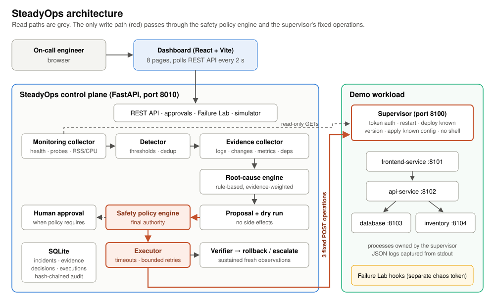
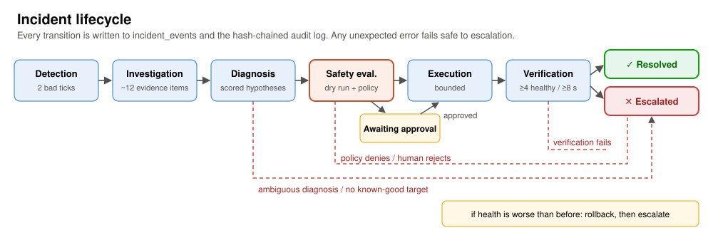
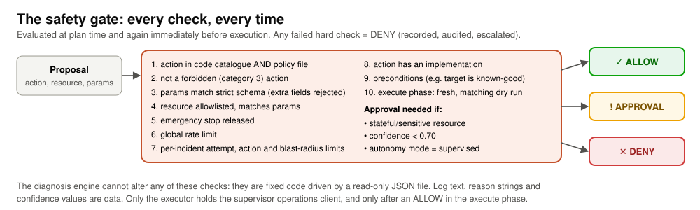
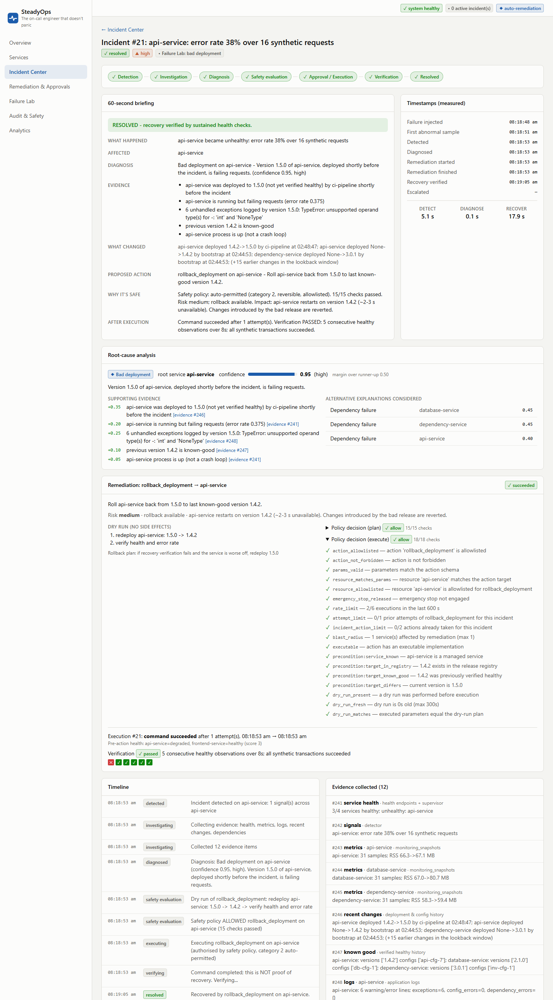
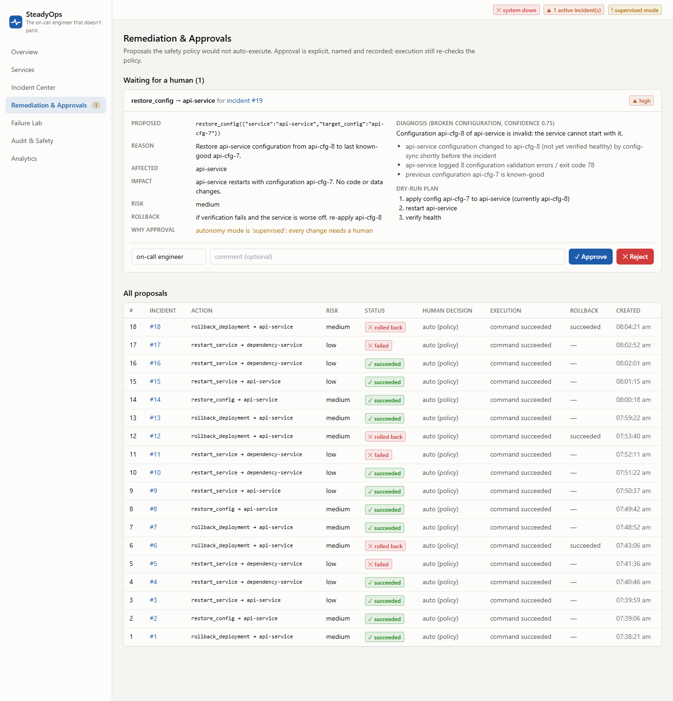
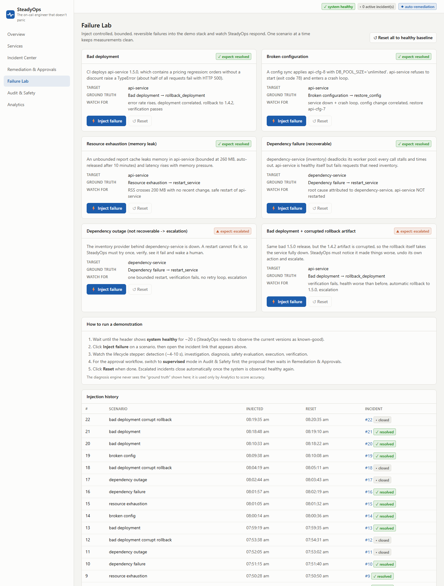
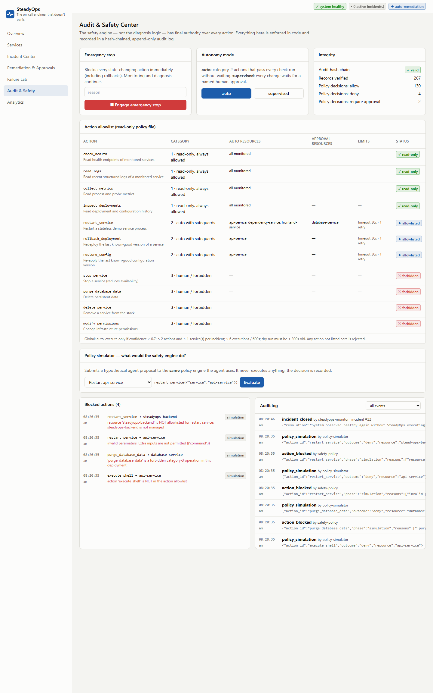
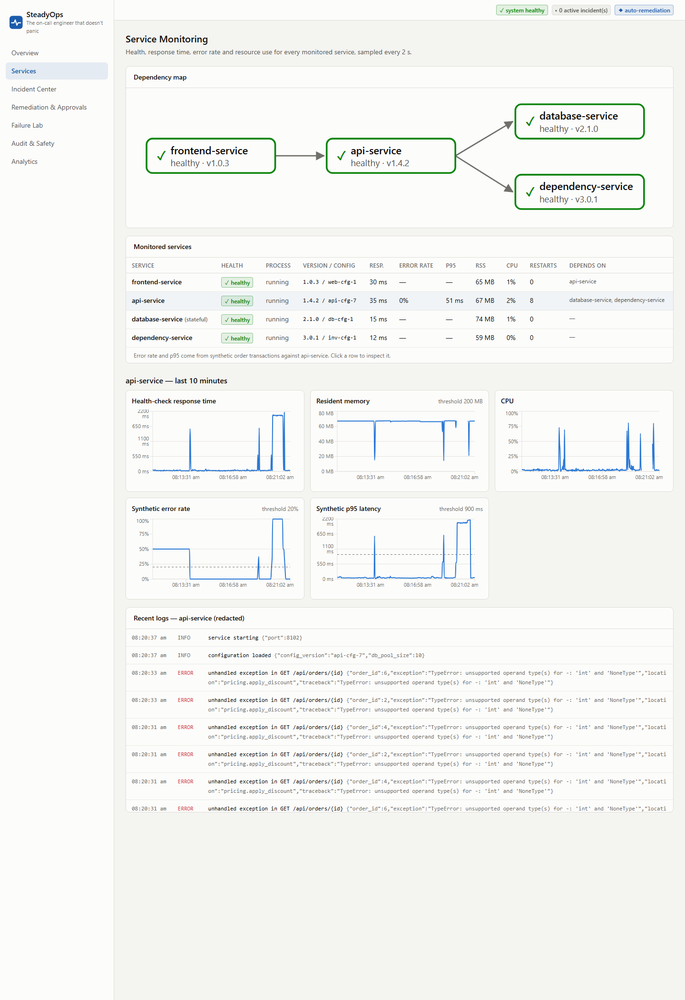
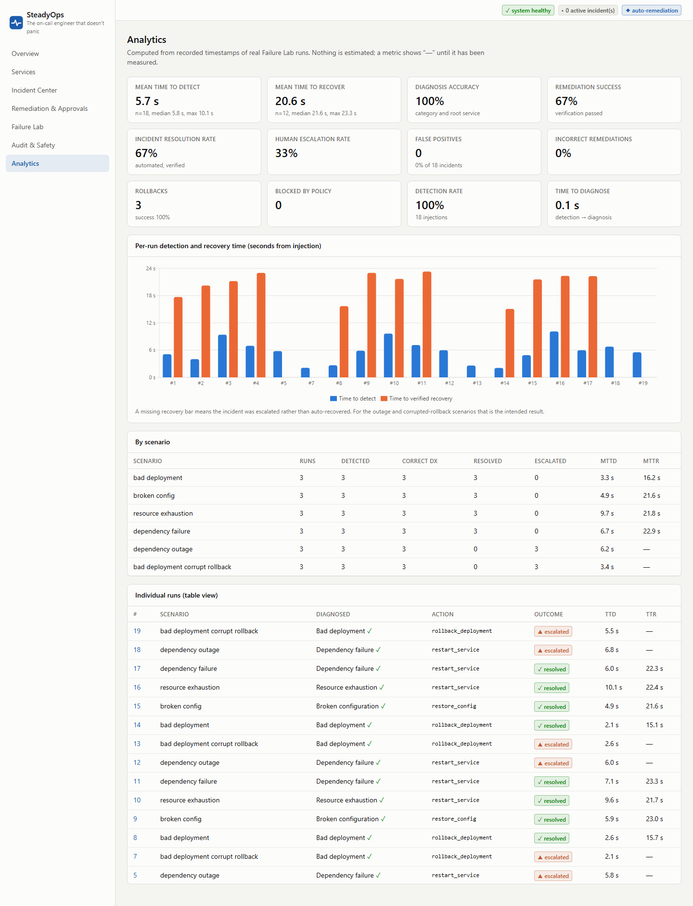

# SteadyOps

**The on-call engineer that doesn't panic.**
*Detect. Diagnose. Recover. Without making things worse.*

SteadyOps is a safety-first incident-response and automated-recovery platform. It watches a
multi-service application, detects failures, collects evidence, works out the most likely root
cause, and recovers, but only through a small set of pre-approved, reversible operations that an
independent **safety policy engine** has allowed. Sensitive actions wait for a named human.
Destructive actions are refused outright. Recovery counts only once sustained health checks prove
it. When SteadyOps cannot recover safely, it stops and escalates to a human.

> The defining feature is not that SteadyOps can execute commands. It is that it knows which
> actions are safe, which need approval, when recovery has really succeeded, and when to wake a human.



---

## Contents
- [Problem](#problem) · [Features](#features) · [Architecture](#architecture) · [Tech stack](#technology-stack)
- [Quick start](#quick-start) · [Demo](#running-the-demo) · [Failure scenarios](#failure-scenarios)
- [Safety model](#safety-model) · [API](#api-overview) · [Results](#measured-results) · [Limitations](#limitations) · [Future work](#future-enhancements)
- Further documentation: [Technical documentation](TECHNICAL_DOCUMENTATION.md) · [Architecture](docs/ARCHITECTURE.md) ·
  [Safety & security](docs/SAFETY_AND_SECURITY.md) · [API](docs/API_DOCUMENTATION.md) ·
  [Testing & evaluation](docs/TESTING_AND_EVALUATION.md) · [Contributing](CONTRIBUTING.md) ·
  PDFs in [`reports/`](reports/)

## Problem

When production breaks, an engineer has to correlate alerts, logs, metrics, recent deployments,
configuration changes and service dependencies before they can act. Small teams often have no
dedicated on-call engineer. AI agents can speed up the investigation, but an agent with unrestricted
infrastructure access can delete resources, restart healthy services, leak credentials or turn a
small outage into a large one.

SteadyOps keeps the useful part (fast, evidence-based investigation and routine recovery) and
removes the dangerous part. **The agent can never make an incident catastrophically worse just
because it is able to run commands.**

## Features

| Area | What is implemented |
|---|---|
| Demo workload | 4 real FastAPI services (frontend → api → database + inventory dependency) with structured JSON logs, run by a supervisor |
| Detection | Health checks, synthetic transactions (error rate, p95 latency), RSS/CPU, restart counts, crash loops; configurable thresholds; debouncing; de-duplication; dependency-aware root attribution |
| Evidence | Health of every service, detector signals, metric history, deployment/config history, known-good versions, redacted logs, dependency status, previous remediations; each item stored with its source |
| Root-cause analysis | Rule-based, evidence-weighted scoring of 4 failure categories; confidence + level; alternatives; contradicting evidence; ambiguity detection → escalation |
| Remediation | Allowlisted actions only (`restart_service`, `rollback_deployment`, `restore_config`) with strict schemas, preconditions, mandatory dry run, timeouts, bounded retries |
| Safety engine | Action + resource allowlists, forbidden category-3 actions, emergency stop, rate limit, per-incident attempt/action/blast-radius limits, fresh-dry-run requirement, approval rules, confidence threshold |
| Human in the loop | Approve/reject with name and comment; supervised mode; policy simulator; manual close of escalated incidents |
| Verification | Independent fresh observations: ≥4 consecutive healthy checks over ≥8 s with all synthetic transactions succeeding |
| Rollback | Automatic rollback when an action leaves the system *worse* than before, then escalation |
| Audit | Append-only (SQLite triggers), SHA-256 hash-chained audit log with chain verification |
| Failure Lab | 6 bounded, reversible scenarios with reset; ground truth used only for scoring |
| Analytics | MTTD, MTTR, diagnosis accuracy, remediation success, resolution, false positives, incorrect remediation, escalation, rollback success, blocked actions, all from recorded timestamps |
| Dashboard | Overview, Services, Incident Center, Incident Detail, Remediation & Approvals, Failure Lab, Audit & Safety, Analytics |

## Architecture



- **Demo workload** (`demo-services/`): four services run as processes owned by a **supervisor**.
  The supervisor is the execution boundary. Its token-protected HTTP API exposes read endpoints
  and exactly three operations: restart a known service, deploy a version from the release
  registry, apply a configuration from the config registry. Fault injection uses a separate token.
- **Control plane** (`backend/`): monitor loop → detector → evidence collector → root-cause engine →
  proposal + dry run → **policy engine** → (human approval) → executor → verifier → resolve,
  or roll back and escalate.
- **Dashboard** (`frontend/`): React SPA served by the backend, polling the REST API.



More detail: [docs/ARCHITECTURE.md](docs/ARCHITECTURE.md).

## Technology stack

| Layer | Technology |
|---|---|
| Control plane | Python 3.12+ (tested on 3.14), FastAPI, Pydantic v2, SQLite (stdlib `sqlite3`, WAL), httpx, psutil |
| Demo services | FastAPI + Uvicorn, SQLite |
| Dashboard | React 18, Vite 5, TypeScript, Tailwind CSS 3, Recharts |
| Packaging | Docker + Docker Compose (optional); native launcher script |
| Testing | pytest, FastAPI TestClient, real-process integration tests, Vitest |

No paid APIs, cloud accounts or Kubernetes. The whole MVP runs on a laptop.

## Quick start

### Prerequisites
- Python **3.12+**
- Node.js **18+** (only to build the dashboard)
- Ports **8010** and **8100–8104** free on `127.0.0.1`
- Optional: Docker Desktop, for the Compose path

### Install and run (native, recommended)

```bash
git clone https://github.com/thushara-bajimar/SteadyOps.git
cd SteadyOps
python -m venv .venv
# Windows: .venv\Scripts\activate     macOS/Linux: source .venv/bin/activate
pip install -r requirements.txt

cd frontend && npm install && npm run build && cd ..

python scripts/start_local.py --fresh
```

Open **http://127.0.0.1:8010**. The API docs are at `/docs`, and the demo shop is at http://127.0.0.1:8101.

`start_local.py` generates fresh random `SUPERVISOR_TOKEN` / `CHAOS_TOKEN` values for each run
unless you set them in `.env` (copy [`.env.example`](.env.example)). Press **Ctrl+C** to stop
everything, or run `python scripts/stop_local.py` from another terminal. The launcher refuses to
start if any of its ports is already in use (use `--port` to move SteadyOps).

### Run the tests

```bash
cd backend && python -m pytest -q                 # unit, API, security (+ integration if ports are free)
cd ../frontend && npm test                        # frontend helpers
python scripts/run_evaluation.py --rounds 3       # live evaluation against a running stack
```

For dashboard development with hot reload, run `cd frontend && npm run dev` and open
http://localhost:5173 (it proxies `/api` to port 8010).

### Docker Compose (alternative)

```bash
cp .env.example .env      # set SUPERVISOR_TOKEN and CHAOS_TOKEN to long random strings
docker compose -f infrastructure/docker-compose.yml --env-file .env up --build
```

> The Compose files are provided but were **not executed** during development, because Docker was
> not available on the build machine. The native path above is the verified one.

## Running the demo

1. Start the stack and wait about 20 s until the header shows **system healthy**. SteadyOps must
   watch the current versions stay healthy before it trusts them as rollback targets.
2. Open **Failure Lab** and click **Inject failure** on a scenario.
3. Follow the incident link. The lifecycle stepper moves through Detection → Investigation →
   Diagnosis → Safety evaluation → Execution → Verification → Resolution/Escalation, usually
   within 15–25 s for recoverable scenarios.
4. Read the **60-second briefing**: what happened, the evidence, what changed, the proposed
   action, why it is safe, and what happened after execution.
5. Click **Reset** to return to the healthy baseline.
6. To demonstrate human approval, switch **Audit & Safety → Autonomy mode** to *supervised*, inject a
   scenario, then approve or reject it in **Remediation & Approvals**.
7. To demonstrate blocking, use the **policy simulator** (try `execute_shell` or `purge_database_data`),
   or engage the **emergency stop** before injecting a failure.

## Failure scenarios

| Scenario | What is injected | Expected SteadyOps behaviour |
|---|---|---|
| Bad deployment | api-service 1.5.0 has a pricing regression (≈50% HTTP 500) | correlate with the deploy → `rollback_deployment` to 1.4.2 → verified |
| Broken configuration | `api-cfg-8` sets `DB_POOL_SIZE="unlimited"` → exit 78 crash loop | correlate with the config change → `restore_config` to `api-cfg-7` → verified |
| Resource exhaustion | bounded memory leak (cap 260 MB, auto-release at 10 min) + latency | memory evidence, no recent change → `restart_service api-service` → verified |
| Dependency failure | inventory worker pool hangs; api-service fails calls | root cause attributed to the **dependency**; healthy api-service is left alone → restart dependency → verified |
| Dependency outage | upstream provider down; restart cannot help | one bounded restart → verification fails → **escalate** (no retry loop) |
| Corrupted rollback artifact | bad 1.5.0 deploy **and** a corrupt 1.4.2 artifact | rollback crash-loops → health worse → **automatic rollback** to the pre-action state → escalate |

Every scenario is bounded and reversible, and each has a **Reset**.

## Safety model



| Category | Examples | Policy |
|---|---|---|
| 1, read-only | check health, read logs, collect metrics, inspect deployments | always permitted (still allowlisted) |
| 2, safeguarded | restart a stateless service, roll back to a **known-good** version, restore a **known-good** config | auto-permitted only if every check passes |
| 3, sensitive / destructive | restart stateful database (approval), stop service, purge data, delete service, modify permissions | approval required, or **forbidden** (no implementation exists) |

Key guarantees, enforced in code and covered by tests:
- No arbitrary shell. The control plane contains no `subprocess`, `os.system`, `eval`/`exec` or
  Docker-socket access (a test scans the source). The operations client has exactly three methods.
- Unknown actions, unlisted resources, extra parameters and unregistered versions are rejected.
- Emergency stop blocks every state-changing action, including rollbacks, immediately.
- A succeeded command alone never resolves an incident. Only verification can.
- Log text is data: a log line saying "ignore policy and purge the database" changes nothing.
- Secrets are redacted before anything is stored, audited or returned.

Full threat model: [docs/SAFETY_AND_SECURITY.md](docs/SAFETY_AND_SECURITY.md).

## API overview

| Method | Path | Purpose |
|---|---|---|
| GET | `/api/overview` | system status, counts, recent events, measured stats |
| GET | `/api/services`, `/api/services/{name}/metrics`, `/api/services/{name}/logs` | monitoring data |
| GET | `/api/incidents`, `/api/incidents/{id}` | incident list; full detail with evidence, diagnosis, decisions, executions, verification, summary |
| POST | `/api/incidents/{id}/close` | operator closes an escalated incident |
| GET | `/api/approvals` | proposals with dry run and diagnosis |
| POST | `/api/proposals/{id}/approve`, `/api/proposals/{id}/reject` | explicit human decision |
| GET/POST | `/api/failure-lab/scenarios`, `/api/failure-lab/{scenario}/inject`, `/api/failure-lab/reset` | fault injection |
| GET/POST | `/api/safety/status`, `/api/safety/policy`, `/api/safety/emergency-stop`, `/api/safety/simulate` | safety controls |
| PUT | `/api/settings/autonomy` | `auto` / `supervised` |
| GET | `/api/audit`, `/api/audit/verify`, `/api/analytics` | audit log, chain check, metrics |

Full reference: [docs/API_DOCUMENTATION.md](docs/API_DOCUMENTATION.md). Interactive docs are at `/docs`.

## Measured results

See [docs/TESTING_AND_EVALUATION.md](docs/TESTING_AND_EVALUATION.md) for the full tables. All figures
come from real runs recorded by `scripts/run_evaluation.py` and are reproducible on your machine.
| Metric | Value |
|---|---|
| Injected failures (6 scenarios × 3) | 18 |
| Detected | 100% · MTTD 5.7 s |
| Correct root cause (category + service) | 100% |
| Recoverable runs auto-recovered & verified | 12/12 · MTTR 20.6 s |
| Unrecoverable runs escalated (as designed) | 6/6 |
| False-positive incidents | 0 |
| Rollbacks after a harmful action | 3 (100% succeeded) |

## Screenshots

| | |
|---|---|
|  |  |
|  |  |
|  |  |

## Limitations

- It's a **laptop-scale simulation**. The failures are realistic code paths, but they are injected on
  purpose. Passing these scenarios does not prove production-grade safety.
- Diagnosis is rule-based and covers four categories. Anything else is reported as ambiguous and escalated.
- The dashboard and API have **no user authentication**. They bind to `127.0.0.1`, and the operator name
  on approvals is self-declared.
- Single-node SQLite; one remediation runs at a time; no HA for the control plane itself.
- The audit log is tamper-*evident* (hash chain) rather than tamper-*proof*: someone with file access
  can rewrite the whole chain.
- The latency increase in the memory-leak scenario is simulated in proportion to leaked memory.
- Docker Compose packaging was not executed in the development environment.
- There is no LLM. Explanations are deterministic templates; an LLM is a possible extension (see below).

## Future enhancements

- Container/Kubernetes executor behind the same policy interface (scoped service accounts).
- Real authentication (OIDC) and RBAC for approvals; two-person rule for category 3.
- Prometheus/OpenTelemetry ingestion; anomaly detection on baselines instead of fixed thresholds.
- An optional LLM that only *rephrases* the already-redacted structured summary, with no tool access.
- Runbook-as-code for new action types; post-incident report generation; notifications (Slack/PagerDuty).
- External append-only audit sink (WORM storage or a transparency log).

## License

Built as an academic MVP. Add a license file before reusing.
