# SteadyOps — Technical Documentation

**SteadyOps: a safety-first AI incident-response and automated-recovery platform**
*Detect. Diagnose. Recover. Without making things worse.*

Domain: Cloud Computing, Cloud Security and MLOps · Version 1.0 (MVP)

---

## Table of contents

1. Abstract
2. Introduction
3. Problem definition
4. Existing systems and their limitations
5. Proposed solution
6. Objectives
7. Scope of the MVP
8. Functional requirements
9. Non-functional requirements
10. System architecture
11. Component descriptions
12. Module-wise implementation
13. Service communication
14. Incident lifecycle
15. Detection methodology
16. Evidence-collection methodology
17. Root-cause analysis
18. Remediation workflow
19. Safety policy and permission model
20. Dry-run implementation
21. Human approval mechanism
22. Rollback mechanism
23. Recovery verification
24. Failure-injection design
25. Database schema and relationships
26. API endpoints
27. Security considerations
28. Testing methodology
29. Evaluation metrics
30. Experimental results
31. Screenshots and sample outputs
32. Limitations
33. Future scope
34. Conclusion
35. References

---

## 1. Abstract

Production incidents force engineers to correlate health checks, logs, metrics, deployments and
configuration changes under time pressure. Autonomous agents could shorten this work, but an agent
with unrestricted infrastructure access can turn a contained failure into a catastrophe. SteadyOps
is a working incident-response system built on one principle: *an agent must never be able to make an
incident catastrophically worse simply because it has the ability to execute commands.*

SteadyOps monitors a four-service application, detects failures from configurable thresholds,
gathers sourced evidence, and diagnoses the root cause with an explainable, evidence-weighted rule
engine that covers bad deployments, broken configurations, resource exhaustion and dependency
failures. It recovers only through three allowlisted, typed operations exposed by a narrow
supervisor API. Every proposal is dry-run first and evaluated by an independent policy engine that
has final authority. Sensitive actions require named human approval, destructive actions are
refused outright, and an emergency stop halts all changes. Recovery is declared only after
sustained, independent verification. If an action leaves the system worse off, SteadyOps rolls it
back and escalates. All decisions are recorded in a hash-chained, append-only audit log.

Evaluated on 18 controlled, real failure injections (six scenarios × three rounds), SteadyOps detected
every failure and identified the correct category and root service in every run. It recovered the
twelve recoverable runs automatically and escalated the six unrecoverable runs as designed, with
zero false-positive incidents. Measured detection and recovery times are reported in Section 30.

## 2. Introduction

Site Reliability Engineering (SRE) measures operational quality by how quickly failures are
detected (MTTD) and recovered from (MTTR). Much of MTTR is spent before any fix is applied:
gathering context, forming hypotheses and ruling out red herrings. Small teams feel this most because
they rarely have a dedicated on-call rotation.

Automation helps, but the industry has learned repeatedly that automation also *amplifies* mistakes:
a script that restarts every unhealthy pod can turn a dependency outage into a fleet-wide restart
storm. AI agents add a new risk, because their actions are generated rather than scripted, and their
input (logs, tickets, web pages) can contain adversarial instructions.

SteadyOps explores a design where an agent is useful *and* bounded. The agent investigates freely
(read-only), but every change passes a deterministic gate that the agent cannot influence.

## 3. Problem definition

Given a multi-service application with observable health, logs, resource metrics and a change
history, build a system that:

1. detects failures quickly and without false alarms from transient blips;
2. identifies the most likely root cause **with supporting evidence** and an honest confidence;
3. proposes a recovery action appropriate to that cause;
4. executes only actions that are allowlisted, bounded, reversible and permitted by policy;
5. obtains human approval for sensitive actions and refuses destructive ones;
6. proves that recovery happened, rather than assuming it;
7. rolls back its own action if that action made things worse;
8. escalates whenever it cannot recover safely;
9. records everything in a form that cannot be silently altered.

## 4. Existing systems and their limitations

| Approach | Strength | Limitation addressed by SteadyOps |
|---|---|---|
| Manual runbooks | Human judgement | Slow; knowledge locked in individuals; error-prone at 3 a.m. |
| Alerting tools (threshold/paging) | Fast detection | Detect only; no diagnosis or recovery |
| Self-healing orchestrators (e.g. restart policies, liveness probes) | Automatic restarts | Symptom-driven: restart whatever is unhealthy, including victims of a dependency failure; no root cause |
| Scripted auto-remediation | Fast for known issues | Usually unbounded retries; rarely verifies recovery; no rollback of its own actions |
| Unrestricted LLM agents with shell access | Flexible reasoning | Can invent destructive commands; vulnerable to prompt injection via logs; no hard safety boundary |

The common gap is that **the component deciding what to do is also the component allowed to do
it**. SteadyOps separates the two.

## 5. Proposed solution

SteadyOps has three tiers:

- **Workload boundary.** A supervisor owns the demo service processes and exposes only fixed,
  registry-validated operations. It plays the role of a container runtime or node agent, but
  without the root-equivalent power of a Docker socket.
- **Control plane.** A pipeline of detector, evidence collector, root-cause engine, policy engine,
  executor and verifier, each with only the privilege it needs.
- **Human interface.** A dashboard that shows live state, explains each incident in plain language,
  and collects explicit approvals.

## 6. Objectives

1. Detect each supported failure within seconds (target < 15 s at a 2 s sampling interval).
2. Diagnose with evidence references for every claim, and refuse to guess when evidence is weak.
3. Recover supported failures automatically, verified, without human involvement in *auto* mode.
4. Never execute an action outside the allowlist, and never touch a non-allowlisted resource.
5. Bound every action in time, retries, rate and blast radius.
6. Escalate unrecoverable situations promptly instead of retrying indefinitely.
7. Make every decision auditable and every metric reproducible.

## 7. Scope of the MVP

**In scope:** a local four-service stack; six failure scenarios (four categories plus two escalation
variants); rule-based diagnosis; three remediation actions; full safety engine; approvals; rollback;
verification; analytics; dashboard; documentation; tests.

**Out of scope:** real cloud resources, Kubernetes, multi-node failure, authentication/RBAC, an LLM,
production-grade audit storage.

## 8. Functional requirements

| ID | Requirement | Implementation |
|---|---|---|
| FR1 | Monitor health, availability, response time, error rate, CPU, memory, dependencies, changes, restarts | `monitoring/collector.py` |
| FR2 | Configurable thresholds | `config/thresholds.json` |
| FR3 | Open incidents when thresholds are crossed; no duplicates | `detection/detector.py` |
| FR4 | Collect and store sourced evidence | `investigation/evidence.py` |
| FR5 | Diagnose ≥ 3 categories with evidence, confidence, alternatives, remediation, approval need | `investigation/rca.py` (4 categories) |
| FR6 | Allowlisted actions with preconditions, dry run, validation, timeout, retries, verification, rollback, audit | `remediation/actions.py`, `remediation/executor.py` |
| FR7 | Three-tier action categories and 14 safety controls | `safety/policy.py`, `config/safety_policy.json` |
| FR8 | Approve/reject with full context | `orchestrator.decide`, Approvals page |
| FR9 | Verify, observe stabilisation, roll back, escalate | `verification/verifier.py`, executor |
| FR10 | Failure Lab with reset | `failure_lab.py`, supervisor `/chaos/*` |
| FR11 | Incident history, audit logs, recovery times | SQLite tables, `analytics.py` |
| FR12 | Dashboard with eight views of real data | `frontend/src/pages/*` |

## 9. Non-functional requirements

| Category | Requirement | How it is met |
|---|---|---|
| Safety | Policy engine is final authority | Executor checks `evaluate(phase="execute")`; ops client held only by executor |
| Explainability | Engineer understands an incident in < 1 min | 60-second briefing; evidence-linked factors |
| Reliability | Pipeline errors never lead to unsafe action | Exceptions escalate (fail safe) |
| Resource bounds | Demo must not freeze a laptop | Leak capped at 260 MB, auto-released after 10 min; hang uses bounded sleeps |
| Portability | Runs on a normal laptop without Docker or paid APIs | Native launcher; stdlib SQLite |
| Security | No secrets in DB/logs/Git; no shell | Redaction, `.gitignore`, source-scan test |
| Performance | Diagnosis in < 1 s | Pure-function RCA (~0.07 s measured) |
| Maintainability | Modular, typed, tested | Package per concern; 64 unit/API/security tests + 2 integration tests + 4 frontend tests |

## 10. System architecture

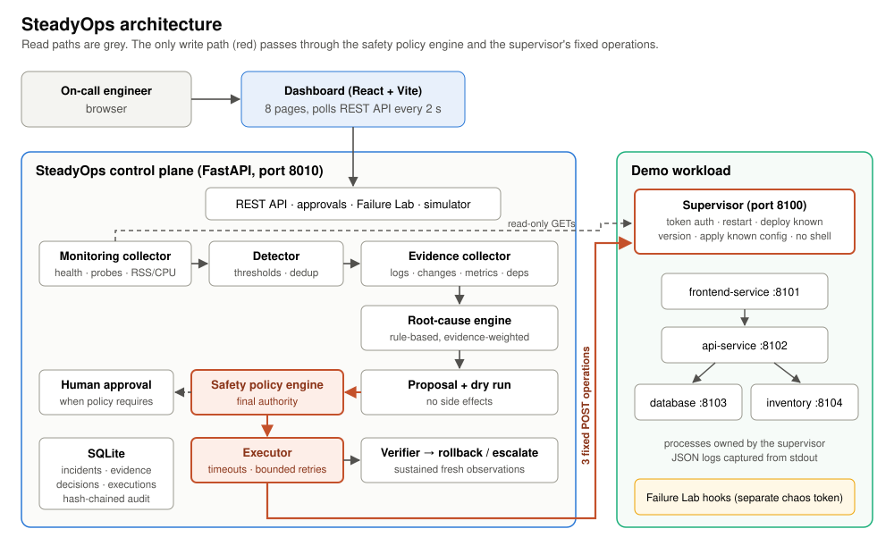

The design keeps three privilege levels strictly apart:

| Privilege | Holder | Can do |
|---|---|---|
| Read | collector, evidence collector, verifier | GET supervisor state, logs, changes; probe health endpoints |
| Decide | detector, RCA, orchestrator, policy engine | write to SteadyOps' own database |
| Change | executor only | three supervisor POST operations, after an ALLOW |

## 11. Component descriptions

**Demo services.**

- *frontend-service*: an HTML shop page plus a proxy to the API.
- *api-service*: order lookups that call database and inventory. It contains the release-1.5.0
  regression, the configuration validation, and the bounded leak hook.
- *database-service*: a SQLite order store. It is stateful, so restarting it needs approval.
- *dependency-service* (inventory): the downstream dependency, with hang and outage modes.

All four emit one JSON object per log line.

**Supervisor.** Starts the services as child processes and restarts them on failure with exponential
backoff (1, 2, 4, 8 s). After three restarts in 120 s it marks the service as being in a crash loop.
It records a change history and serves a token-protected API. On Windows, venv launchers spawn a
child interpreter, so the supervisor measures and terminates whole process trees.

**SteadyOps control plane.** Described module by module in Section 12.

**Dashboard.** Eight React pages that poll the API every 2–3 s.

## 12. Module-wise implementation

### 12.1 Configuration (`app/config.py`)
`Settings` reads environment variables (tokens, URLs, database path, autonomy mode) and the two JSON
files. Tokens are declared `repr=False`, so they never appear in logs or exception messages.

### 12.2 Clients (`app/clients.py`)
Three classes enforce least privilege inside the process. The operations client has exactly three
public methods, and each one validates its input against a strict regex before any request is sent:

```python
class SupervisorOpsClient:
    """The ONLY object in SteadyOps able to change the demo stack."""
    def restart(self, service: str) -> dict:
        return self._post(f"/services/{_check_service(service)}/restart")
    def deploy(self, service: str, version: str) -> dict: ...
    def apply_config(self, service: str, config_version: str) -> dict: ...
```

### 12.3 Monitoring (`app/monitoring/collector.py`)
Each tick runs health checks and four synthetic `GET /api/orders/{id}` transactions in parallel. It
then computes a sliding-window error rate and p95 latency, classifies every service as
healthy / degraded / down, stores snapshots, mirrors the change history, and marks the
version/config of any service that has been continuously healthy for 20 s as **known-good**. It also
records `tick_failures` and `tick_max_ms` so that windowed metrics only signal while the problem is
still happening now (Section 15).

### 12.4 Detection (`app/detection/detector.py`)
`compute_signals()` is a pure function, and `Detector.process()` debounces, de-duplicates and
attributes (Section 15).

### 12.5 Evidence (`app/investigation/evidence.py`)
Stores eight kinds of evidence (Section 16) and returns the RCA context. Every log record is redacted
at ingestion.

### 12.6 Root-cause analysis (`app/investigation/rca.py`)
A pure function `diagnose(ctx, thresholds)` (Section 17).

### 12.7 Actions (`app/remediation/actions.py`)
Each action is a class with a Pydantic `Params` model (`extra="forbid"`, frozen) and methods
`preconditions`, `plan` (dry run), `execute` and `rollback`.

### 12.8 Policy (`app/safety/policy.py`)
`PolicyEngine.evaluate()` runs up to fourteen checks and returns allow, require_approval or deny,
with a reason for each check (Section 19).

### 12.9 Executor (`app/remediation/executor.py`) and Verifier (`app/verification/verifier.py`)
Sections 18, 22 and 23.

### 12.10 Orchestrator (`app/orchestrator.py`)
Runs the monitor loop on a dedicated thread and launches one pipeline thread per new incident. A
`_running` set prevents two pipelines from working on the same incident. Any exception in a pipeline
escalates the incident:

```python
except Exception as exc:
    inc = self.rt.incidents.get(incident_id)
    if inc and inc["status"] == "open":
        self.rt.incidents.escalate(incident_id, f"internal error in SteadyOps pipeline ({type(exc).__name__}); "
                                                "failing safe - no further automated action")
```

### 12.11 Audit (`app/safety/audit.py`)
`record()` computes `sha256(json([prev_hash, ts, actor, event_type, incident_id, payload_json]))`
under a lock, and `verify_chain()` recomputes the whole chain. SQLite triggers abort any UPDATE or
DELETE.

### 12.12 Analytics (`app/analytics.py`)
Joins `failure_injections` (ground truth) with incidents, executions, verifications and rollbacks
(Section 29).

### 12.13 Dashboard (`frontend/`)
`usePoll` hooks drive the pages from the API. Colours are CSS tokens with separately tuned light and
dark values. Status is always shown as an icon plus a word, never colour alone. Charts follow a
validated palette, use thin lines, and include threshold reference lines and tooltips.

## 13. Service communication

| From | To | Protocol | Auth |
|---|---|---|---|
| Browser | SteadyOps API | HTTP/JSON | none (localhost) |
| Collector / evidence / verifier | supervisor GET endpoints | HTTP | `X-Supervisor-Token` |
| Executor | supervisor POST operations | HTTP | `X-Supervisor-Token` + `X-Actor: steadyops-agent` |
| Failure Lab | supervisor `/chaos/*` | HTTP | `X-Chaos-Token` |
| Collector | every service `/health`; api `/api/orders/{id}` | HTTP | none |
| Supervisor | child `/internal/chaos/*` | HTTP | `X-Chaos-Token` |
| frontend → api → database, inventory | business calls | HTTP | none |

## 14. Incident lifecycle

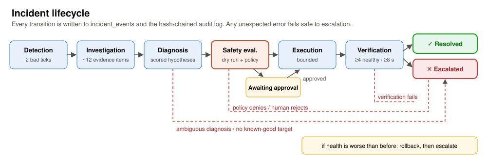

Every stage change writes an `incident_events` row (append-only) and an audit record where relevant.
Timestamps are stored separately for injection, first abnormal sample, detection, diagnosis,
remediation start and end, verification, resolution and escalation. This keeps *detected*,
*diagnosed*, *approved*, *executed* and *verified* distinct.

## 15. Detection methodology

**Signals.** Per service, per tick:

| Signal | Condition (default) | Severity |
|---|---|---|
| service_down | supervisor process state ≠ running | critical |
| crash_loop | ≥ 2 restarts in 120 s | critical |
| health_check_failed | `/health` connection error or timeout (2.5 s) | high |
| health_degraded | `/health` non-200 or `status ≠ ok` | high |
| high_error_rate | window error rate ≥ 20 % over ≥ 6 samples **and** failures in the current tick | high |
| high_latency | window p95 ≥ 900 ms **and** a request ≥ 900 ms in the current tick | medium |
| high_memory | RSS ≥ 200 MB | medium |
| high_cpu | CPU ≥ 95 % | medium |

**Debouncing.** A service counts as abnormal only after signals persist for 2 consecutive ticks.
The "current tick" condition on windowed metrics came out of testing. Without it, one bad tick
stayed in the 4-tick window long enough to open a false-positive incident
(`test_transient_blip_does_not_open_incident` caught this).

**De-duplication.** While an incident is `open` or `escalated`, new abnormal services attach to it
(and are recorded in the timeline) instead of opening new incidents. A 10 s cooldown after a
resolution absorbs residual noise.

**Root attribution.** `pick_root` chooses the abnormal service none of whose dependencies are
abnormal. When the inventory service hangs, both it and api-service are abnormal; the incident is
attributed to `dependency-service`.

**Blindness rule.** If the supervisor is unreachable, the detector does not open incidents, because
it cannot see process state.

## 16. Evidence-collection methodology

For the detected service, the affected services and their dependencies:

| Evidence | Source | Used for |
|---|---|---|
| service_health | live observation | which services are failing and how |
| signals | detector | what crossed which threshold |
| metrics | `monitoring_snapshots` from 60 s before onset | memory growth, latency, error-rate history |
| recent_changes | deployments, config changes, runtime events (15 min lookback) | correlation with changes |
| known_good | `known_good` table | safe rollback targets |
| logs | supervisor log buffer from 90 s before onset, WARN/ERROR/FATAL, redacted | exceptions, config errors, dependency errors |
| dependency_status | dependency graph + health | upstream vs downstream |
| previous_remediations | executions in the last hour | repeat-failure awareness |

`analyse_logs()` counts structured indicators only: exceptions tagged with a version, FATAL
configuration messages, exit code 78, records carrying a `dependency` field, memory/cache warnings,
artifact errors and provider errors. It never interprets free text as instructions.

## 17. Root-cause analysis

For each candidate service, four hypotheses are scored by adding weighted factors and clipping the
total to [0, 1]. Each factor that fires is recorded with its text and the evidence item behind it.

| Hypothesis | Main positive factors (weight) | Main negative factors |
|---|---|---|
| Bad deployment | latest deploy is not known-good (0.35); running but failing (0.20); exceptions from the current version (0.25); a known-good previous version exists (0.10); process up (0.05) | unhealthy dependency (−0.40); config errors (−0.30); recent config change (−0.10) |
| Broken config | latest config change is not known-good (0.35); not staying up (0.20); config validation errors / exit 78 (0.30); known-good previous config (0.10) | unhealthy dependency (−0.30); deploy without config change (−0.20) |
| Resource exhaustion | memory above threshold (0.40); growth ≥ 50 MB (0.15); slow or CPU-bound (0.15); no unverified change (0.10); memory warnings (0.10) | unhealthy dependency (−0.30); unverified deploy (−0.20) |
| Dependency failure (service is the failing dependency) | itself down/degraded (0.30); dependents impacted (0.25); dependents' logs blame it (0.20); no unverified change to it (0.10); its own dependencies healthy (0.10) | memory exhaustion (−0.20) |

Only the **latest** change counts, and only if what it introduced has never been verified healthy.
Earlier changes are superseded. This fixed a bug in which an old bad deploy, already reverted, kept
implicating later incidents.

**Confidence and ambiguity.** Confidence is the top score: *high* ≥ 0.75, *medium* ≥ 0.50, *low*
otherwise. A diagnosis is ambiguous if the top score is below 0.50 or beats the runner-up by less
than 0.15. Ambiguous diagnoses carry no recommendation, and the incident is escalated.

**Recommendation.**

| Category | Action | Target |
|---|---|---|
| bad_deployment | `rollback_deployment` | most recently verified known-good version ≠ current (none → escalate) |
| broken_config | `restore_config` | most recently verified known-good config ≠ current (none → escalate) |
| resource_exhaustion | `restart_service` | the exhausted service |
| dependency_failure | `restart_service` | the failing dependency, never the healthy dependents |

Example (measured, bad deployment):
```
Diagnosis: Bad deployment on api-service (confidence 0.95, high)
 +0.35 api-service was deployed to 1.5.0 (not yet verified healthy) by ci-pipeline shortly before the incident
 +0.20 api-service is running but failing requests (error rate 0.375)
 +0.25 6 unhandled exceptions logged by version 1.5.0: TypeError: unsupported operand type(s) for -: 'int' and 'NoneType'
 +0.10 previous version 1.4.2 is known-good
 +0.05 api-service process is up (not a crash loop)
Alternatives: dependency_failure(api-service) 0.40, ...
```

## 18. Remediation workflow

1. The orchestrator turns the recommendation into a proposal: action, resource, params, reason,
   risk, expected impact, rollback availability.
2. **Dry run.** `action.dry_run()` reads current state and returns steps, current/target state,
   expected impact, rollback plan and precondition results. It makes no changes (Section 20).
3. **Plan-phase policy.** The outcome is allow, require_approval or deny (Section 19).
4. **Execute-phase policy.** The executor re-reads state and re-evaluates with the latest dry run
   and any approval.
5. **Pre-state.** The executor records version, config, process state and the health score of the
   check set (target + affected services + target's dependents).
6. **Bounded execution.** Each attempt runs in a worker thread with `timeout_s`. A transport error
   is retried up to `max_retries`. A timeout is **not** retried, because the resulting state is
   unknown. The emergency stop is checked before every attempt.
7. The probe window is cleared, so stale pre-fix samples cannot re-trigger detection.
8. Verification (Section 23), then resolution, or rollback and escalation (Section 22).

## 19. Safety policy and permission model

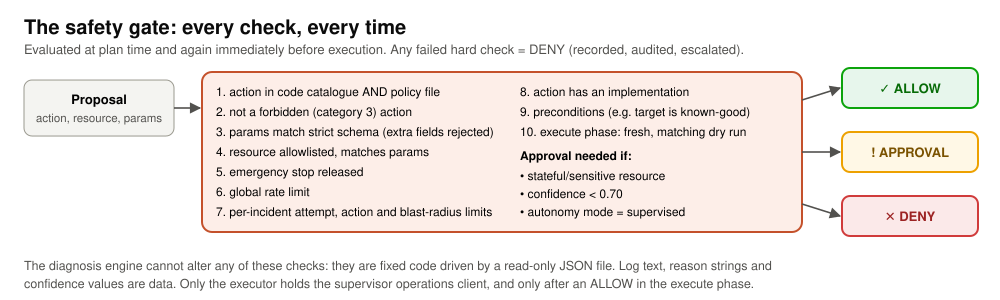

Policy file excerpt (`backend/config/safety_policy.json`):
```json
"restart_service": {"category": 2, "resources": ["api-service","dependency-service","frontend-service"],
                    "approval_resources": ["database-service"], "timeout_s": 30, "max_retries": 1,
                    "max_attempts_per_incident": 1},
"purge_database_data": {"category": 3, "description": "Delete persistent data", "forbidden": true}
```

Mapping of the fourteen required controls:

| # | Control | Where |
|---|---|---|
| 1 | Dry run before execution | `dry_run_present/fresh/matches` checks |
| 2 | Action allowlist | `action_allowlisted` (code catalogue ∩ policy file) |
| 3 | Resource allowlist | `resource_allowlisted`, `resource_matches_params`; supervisor registry |
| 4 | Least privilege | three clients; ops client only in the executor |
| 5 | Execution timeouts | `timeout_s` per action (future with timeout) |
| 6 | Maximum retries | `max_retries`; `attempt_limit` per incident |
| 7 | Rate limits | 6 executions / 600 s globally |
| 8 | Max affected services per incident | `blast_radius` (1) |
| 9 | Preconditions | per action (target in registry, known-good, differs from current) |
| 10 | Post-action verification | `Verifier` |
| 11 | Rollback | `action.rollback` when health got worse |
| 12 | Human approval | `require_approval` outcomes; approvals table |
| 13 | Append-only audit | triggers + hash chain |
| 14 | Emergency stop | `emergency_stop_released` check + executor checks |

**Why the agent cannot override the policy.** The engine's inputs are the action id, resource,
params, confidence number and database state. Free text (reasons, logs) is never read by any check.
The policy file is read once and cannot be modified through any API. Autonomy mode and emergency
stop can be changed only through operator endpoints, and every change is audited.

## 20. Dry-run implementation

`RemediationAction.dry_run()` validates params, calls `plan()` (pure: reads only the supplied state
snapshot) and attaches precondition results. The orchestrator stores the plan and its SHA-256 hash.
At execution the policy requires a dry run that is (a) present, (b) at most 300 s old, and (c)
self-consistent: the stored hash matches the stored plan, and the plan's params equal the
parameters being executed. A test asserts that dry runs of all three actions perform zero supervisor
operations and leave the observed state identical.

## 21. Human approval mechanism

A proposal enters `awaiting_approval` with the policy's reasons. The Approvals page and the incident
page show the proposed action, its reason, the diagnosis and evidence, the affected service, impact,
risk, rollback plan, and why approval is needed. The operator enters a name (and an optional comment) and
approves or rejects. `decide()`:

- rejects anything that is not `awaiting_approval` (no double approval; `approvals.proposal_id` is UNIQUE);
- on reject, escalates without executing;
- on approve, recomputes the dry run; if the plan hash changed (the system moved on), the proposal
  expires and the incident escalates; otherwise it schedules the executor, which still runs the full
  execute-phase policy check.

## 22. Rollback mechanism

After a failed verification the executor compares health scores (healthy 2, degraded 1, down 0,
summed over the check set). If the score fell and the action declares `rollback_available`, it calls
`action.rollback(pre_state)`, which redeploys the pre-action version or re-applies the pre-action
config. It records the result in `rollbacks`, sets the proposal to `rolled_back`, and escalates. If
the score did not fall, there is no rollback, because reverting to a known-broken state helps nobody.
`restart_service` has no rollback because a restart changes no version or configuration. The
emergency stop also blocks rollbacks.

The *corrupted rollback artifact* scenario exercises this path live: rolling back to 1.4.2
crash-loops (exit 125), so the score drops from 3 (api degraded + frontend healthy) to 2 (api down).
SteadyOps restores 1.5.0, which keeps the service partially available, and escalates.

## 23. Recovery verification

The verifier repeatedly takes **fresh** observations (it does not use the sliding window), every 2 s:

- for every service in the check set, no detection signal of any kind;
- end-to-end synthetic transactions: every probe in the tick must succeed;
- the supervisor must be reachable to confirm process state.

It passes after ≥ 4 consecutive healthy observations spanning ≥ 8 s, and fails if this has not
happened within 45 s. Every observation is stored with its list of problems, and the dashboard
shows them as a strip of ✓/✕ cells. Only a passed verification can set `status = resolved`.

## 24. Failure-injection design

| Scenario | Mechanism (real code path) | Bounds / reset |
|---|---|---|
| bad_deployment | supervisor deploys api 1.5.0 as actor `ci-pipeline`; `apply_discount` drops its None guard → TypeError on discount-less orders | reset redeploys 1.4.2 |
| broken_config | supervisor applies `api-cfg-8` (`DB_POOL_SIZE: "unlimited"`); startup validation exits 78; supervisor backoff → crash loop | reset applies `api-cfg-7` |
| resource_exhaustion | api allocates 10 MB every 0.5 s up to 260 MB; latency `min(2 s, (MB−120)/100)` models GC pressure | hard cap; self-releases after 600 s; reset frees; restart frees |
| dependency_failure | inventory sets an in-memory `hung` flag: each request logs, sleeps 4 s, returns 503 | restart clears; reset restarts |
| dependency_outage | as above, plus `PROVIDER_OUTAGE=1` for future starts, so restart does not help | reset clears flag and restarts |
| bad_deployment_corrupt_rollback | 1.4.2 marked as a corrupt artifact (start fails, exit 125) plus the bad deploy | reset clears artifacts and redeploys |

**Honesty rules.** The supervisor's change history records deployments, config changes, restarts and
exits, which a real platform would also log. It does **not** record "leak injected" or "hang
injected", so the RCA cannot cheat. Ground truth (`expected_category`, `expected_action`) lives in
`failure_injections` and is read only by analytics.

## 25. Database schema and relationships

```
services 1─* service_dependencies
services 1─* deployments, config_changes, runtime_events, known_good, monitoring_snapshots
incidents 1─* incident_events (append-only), evidence, diagnoses, remediation_proposals, policy_decisions
diagnoses 1─* remediation_proposals
remediation_proposals 1─* dry_runs, policy_decisions; 1─1 approvals; 1─* remediation_executions
remediation_executions 1─* verifications, rollbacks
failure_injections *─1 incidents
audit_events (append-only, hash-chained)      settings (autonomy_mode, emergency_stop)
```

| Table | Key columns | Notes |
|---|---|---|
| incidents | status (CHECK open/resolved/escalated/closed), stage, severity (CHECK), detected_service, root_service, category, 9 lifecycle timestamps | indexed by status |
| diagnoses | category, confidence (CHECK 0..1), confidence_level (CHECK), ambiguous, supporting/alternatives/recommended JSON | |
| remediation_proposals | action_id, resource, params_json, status (CHECK, 10 values), approval_reason | |
| policy_decisions | phase (plan/execute/simulation), outcome (allow/require_approval/deny), reasons, checks | indexed by outcome |
| approvals | proposal_id UNIQUE, decision CHECK, approver | one decision per proposal |
| remediation_executions | status (running/command_succeeded/command_failed/aborted), attempts, pre_state | the word "succeeded" refers only to the command |
| verifications | result (passed/failed), checks_json | the only route to "resolved" |
| audit_events | prev_hash, hash UNIQUE | UPDATE/DELETE triggers abort |

No passwords or tokens are stored. Log-derived evidence is redacted before insertion.

## 26. API endpoints

See [docs/API_DOCUMENTATION.md](docs/API_DOCUMENTATION.md). In brief: read endpoints for overview,
services, metrics, logs, incidents, approvals, safety status/policy, audit and analytics; write
endpoints only for approve/reject, close an escalated incident, inject/reset Failure Lab scenarios,
emergency stop, autonomy mode and the (non-executing) policy simulator. **There is no endpoint that
executes an arbitrary action**, and a test asserts that no route path contains
`exec`/`shell`/`command`/`run`.

## 27. Security considerations

Covered in depth in [docs/SAFETY_AND_SECURITY.md](docs/SAFETY_AND_SECURITY.md): a 16-item threat
model with a test for each mitigation, permission boundaries, secrets handling, and an explicit list
of what the MVP does not guarantee (no authentication, tamper-evident but not tamper-proof audit,
no process sandboxing on the native path, laptop-scale validation only).

## 28. Testing methodology

| Level | Tool | What it does |
|---|---|---|
| Unit / component | pytest + an in-memory `World` that mirrors the demo services' behaviours | Runs the real collector, detector, evidence, RCA, policy, executor and verifier against simulated faults, with a fake clock for fast verification |
| API | FastAPI TestClient with the fake world | Full incident flow through HTTP; validation; redaction; simulator never executes |
| Security | pytest | Redaction, audit tamper detection, source scan for shell primitives, ops-client surface, no execute route, `.gitignore` of private notes and `.env` |
| Integration | pytest starting the **real** supervisor and services | Real fault injection → detection → diagnosis → remediation → verification, with measured TTD/TTR |
| Frontend | Vitest + TypeScript strict build | Formatting/lifecycle helpers; full type check |
| Evaluation | `scripts/run_evaluation.py` against a running stack | 6 scenarios × N rounds, with metrics written to `reports/` |

Defects found by testing and evaluation, each fixed with a regression test:

| # | Defect | How it was found | Fix |
|---|---|---|---|
| 1 | One bad tick lingering in the error-rate window opened a false-positive incident | `test_transient_blip_does_not_open_incident` | windowed signals also require failures in the current tick |
| 2 | The same lingering effect for p95 latency | same test | latency signal requires a slow request in the current tick |
| 3 | Exception text containing a token was copied into a diagnosis factor before redaction | `test_secrets_in_service_logs_never_reach_evidence_or_audit` | redact log records at ingestion |
| 4 | An old, superseded bad deployment implicated later incidents | development review | only the latest change counts |
| 5 | Logs from an already-fixed incident (FATAL config errors) lowered the confidence of the next diagnosis to 0.65 (it then, correctly, waited for approval) | live demo run, back-to-back scenarios | log evidence starts at the service's most recent deliberate change; `test_logs_from_a_previous_incident_do_not_contaminate_the_next` |
| 6 | Analytics used `NOT IN (NULL)`, silently zeroing verification and rollback metrics when no run was excluded | cross-checking the evaluation report against the raw database | sentinel id; `test_rollback_metrics_counted` |

The evaluation process itself also surfaced two operational issues: the global rate limit blocking an
unpaced harness (the control working as designed), and a host suspend invalidating a run (now detected and excluded).

## 29. Evaluation metrics

| Metric | Definition |
|---|---|
| MTTD | mean(detected_at − injected_at) |
| MTTR | mean(resolved_at − injected_at) over verified recoveries |
| Detect → recover | mean(resolved_at − detected_at) |
| Diagnosis accuracy | runs whose diagnosed category **and** root service equal ground truth ÷ diagnosed runs |
| Remediation success rate | verifications passed ÷ verifications run |
| Incident resolution rate | incidents auto-resolved ÷ non-open incidents |
| False-positive rate | incidents not linked to any injection ÷ incidents |
| Incorrect-remediation rate | first executed action/resource ≠ expected ÷ runs with an execution |
| Human escalation rate | incidents ever escalated ÷ incidents |
| Rollback success rate | rollbacks succeeded ÷ rollbacks attempted |
| Blocked actions | policy decisions with outcome *deny* |

Escalation is the **correct** outcome for `dependency_outage` and `bad_deployment_corrupt_rollback`.
The resolution and escalation rates therefore reflect the scenario mix, not a failure.

## 30. Experimental results

Generated 2026-11-19T13:53:23 UTC by `scripts/run_evaluation.py --rounds 3` on a fresh database.
Raw data: [`reports/evaluation_results.json`](reports/evaluation_results.json), [`reports/evaluation_results.md`](reports/evaluation_results.md).

### Summary

| Metric | Measured value |
|---|---|
| Controlled failure injections | 18 (3 rounds × 6 scenarios) |
| Incidents recorded | 18 |
| Detection rate | 100% |
| **MTTD** (injection → detection) | 5.7 s (median 5.8 s, min 2.1 s, max 10.1 s, n=18) |
| **MTTR** (injection → verified recovery, recoverable runs) | 20.6 s (median 21.6 s, min 15.1 s, max 23.3 s, n=12) |
| Detection → verified recovery | 14.4 s (median 14.6 s, min 11.8 s, max 17.1 s, n=12) |
| Detection → diagnosis | 0.1 s (median 0.1 s, min 0.0 s, max 0.1 s, n=18) |
| Diagnosis accuracy (category **and** root service) | 100% |
| Runs ending in the *expected* outcome (resolve vs. escalate) | 18/18 |
| Remediation success rate (verification passed) | 67% |
| Incorrect-remediation rate | 0% |
| Incident resolution rate (automated) | 67% |
| False-positive incidents | 0 (0%) |
| Human escalation rate | 33% (all from the two escalation scenarios) |
| Rollbacks executed / success rate | 3 / 100% |
| Actions blocked by the safety policy (this run) | 0 |
| Excluded runs | 1 |
| Audit hash chain after evaluation | valid (222 records) |

### Per scenario

| Scenario | Runs | Detected | Correct diagnosis | Resolved | Escalated | MTTD | MTTR |
|---|---|---|---|---|---|---|---|
| bad_deployment | 3 | 3 | 3 | 3 | 0 | 3.3 s | 16.2 s |
| broken_config | 3 | 3 | 3 | 3 | 0 | 4.9 s | 21.6 s |
| resource_exhaustion | 3 | 3 | 3 | 3 | 0 | 9.7 s | 21.8 s |
| dependency_failure | 3 | 3 | 3 | 3 | 0 | 6.7 s | 22.9 s |
| dependency_outage | 3 | 3 | 3 | 0 | 3 | 6.2 s | n/a |
| bad_deployment_corrupt_rollback | 3 | 3 | 3 | 0 | 3 | 3.4 s | n/a |

### Individual runs

| # | Scenario | Diagnosed | Action executed | Outcome | TTD | TTR | Escalated after |
|---|---|---|---|---|---|---|---|
| 1 | bad_deployment | bad_deployment ✓ | rollback_deployment | resolved | 5.1 s | 17.7 s | n/a |
| 2 | broken_config | broken_config ✓ | restore_config | resolved | 4.0 s | 20.2 s | n/a |
| 3 | resource_exhaustion | resource_exhaustion ✓ | restart_service | resolved | 9.4 s | 21.2 s | n/a |
| 4 | dependency_failure | dependency_failure ✓ | restart_service | resolved | 7.0 s | 23.0 s | n/a |
| 5 | dependency_outage | dependency_failure ✓ | restart_service | escalated | 5.8 s | n/a | 58.1 s |
| 7 | bad_deployment_corrupt_rollback | bad_deployment ✓ | rollback_deployment | escalated | 2.1 s | n/a | 50.6 s |
| 8 | bad_deployment | bad_deployment ✓ | rollback_deployment | resolved | 2.6 s | 15.7 s | n/a |
| 9 | broken_config | broken_config ✓ | restore_config | resolved | 5.9 s | 23.0 s | n/a |
| 10 | resource_exhaustion | resource_exhaustion ✓ | restart_service | resolved | 9.6 s | 21.7 s | n/a |
| 11 | dependency_failure | dependency_failure ✓ | restart_service | resolved | 7.1 s | 23.3 s | n/a |
| 12 | dependency_outage | dependency_failure ✓ | restart_service | escalated | 6.0 s | n/a | 56.7 s |
| 13 | bad_deployment_corrupt_rollback | bad_deployment ✓ | rollback_deployment | escalated | 2.6 s | n/a | 51.1 s |
| 14 | bad_deployment | bad_deployment ✓ | rollback_deployment | resolved | 2.1 s | 15.1 s | n/a |
| 15 | broken_config | broken_config ✓ | restore_config | resolved | 4.9 s | 21.6 s | n/a |
| 16 | resource_exhaustion | resource_exhaustion ✓ | restart_service | resolved | 10.1 s | 22.4 s | n/a |
| 17 | dependency_failure | dependency_failure ✓ | restart_service | resolved | 6.0 s | 22.3 s | n/a |
| 18 | dependency_outage | dependency_failure ✓ | restart_service | escalated | 6.8 s | n/a | 55.5 s |
| 19 | bad_deployment_corrupt_rollback | bad_deployment ✓ | rollback_deployment | escalated | 5.5 s | n/a | 54.4 s |

**Interpretation.**

- All 18 injected failures were detected; there were 0 false-positive incidents.
- Every diagnosis named the correct category and root service (100%). For the dependency
  scenarios this means the incident was attributed to `dependency-service`, and the healthy-but-affected
  `api-service` was never restarted.
- The 12 recoverable runs were all recovered automatically and verified. MTTR averaged 20.6 s;
  roughly 8–10 s of that is the deliberate stabilisation window the verifier requires before declaring recovery.
- The 6 escalations are the two scenarios designed to be unrecoverable. In `dependency_outage` exactly one
  bounded restart was attempted before escalating. In `bad_deployment_corrupt_rollback` the rollback itself crash-looped,
  SteadyOps detected that health had dropped, rolled back to the pre-action version (rollbacks: 3, success 100%),
  then escalated. Their verification failures account for the remediation success rate of 67%.
- Resource exhaustion has the slowest detection (9.7 s) because the leak
  must grow past the 200 MB threshold; bad deployments are fastest (the error rate crosses 20% within ~2 samples).
- Detection → diagnosis takes about 0.1 s: rule-based RCA over stored evidence is effectively instantaneous.

### Excluded runs

| # | Scenario | Reason |
|---|---|---|
| 6 | bad_deployment_corrupt_rollback | host suspended mid-run (wall clock jumped 8579s); timings invalid |

**Evaluation history (all attempts, kept for transparency).**

1. *Unpaced harness.* The first attempt injected faster than the policy's global rate limit (6 executions / 600 s).
   Runs 7–10 were diagnosed correctly, but the safety policy denied execution (`6/6 executions in the last 600 s`)
   and escalated them. This is the control working as designed. The harness was changed to wait for the window;
   the policy was not loosened. Records: `reports/rate_limit_observation_*`.
2. *Host suspend.* The second attempt ran overnight. The laptop suspended right after one injection and resumed 7 h 20 min
   later, so that run's timings were meaningless. The attempt was discarded, the harness gained wall-clock-jump
   detection (affected runs are excluded with an audited reason and repeated), and it now keeps Windows awake
   only while it runs.
3. *Clean run on the previous code.* 18 injections, detection rate 100%, diagnosis accuracy 100%, 0 false positives,
   MTTD 5.6 s, MTTR 21.0 s. Afterwards a back-to-back demo exposed defect #5
   (stale logs from a fixed incident lowering the next diagnosis), which was fixed.
4. *Final run on the final code* (fresh database): the results reported above. The laptop suspended
   during this attempt too (run #6). The harness detected the clock jump, excluded that run with an audited
   reason (see *Excluded runs*), and the evaluation was completed with `--resume`, which keeps the valid
   runs already recorded and runs only the missing ones.


## 31. Screenshots and sample outputs

**Overview**

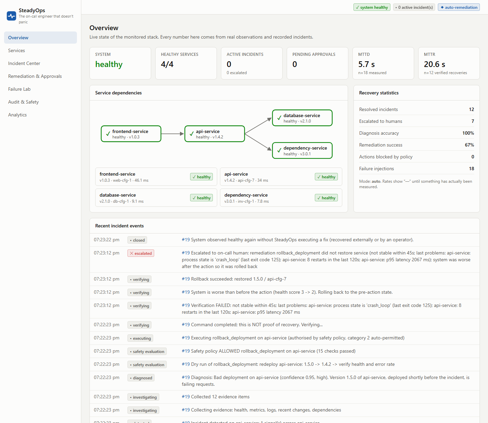

**Incident detail: resolved bad deployment**

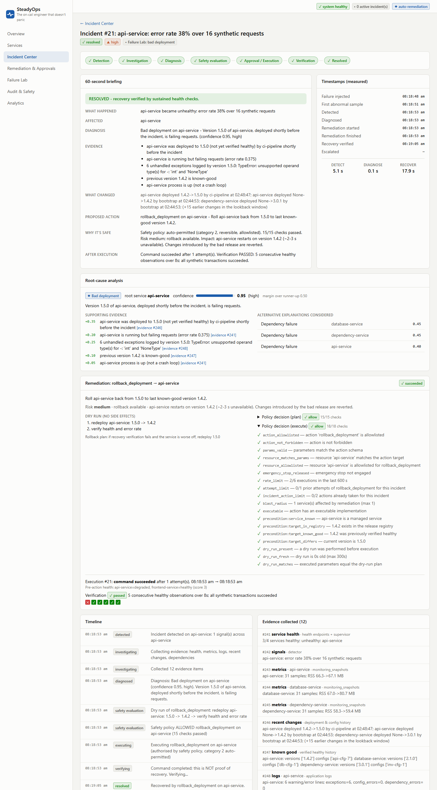

**Incident detail: rollback and escalation**

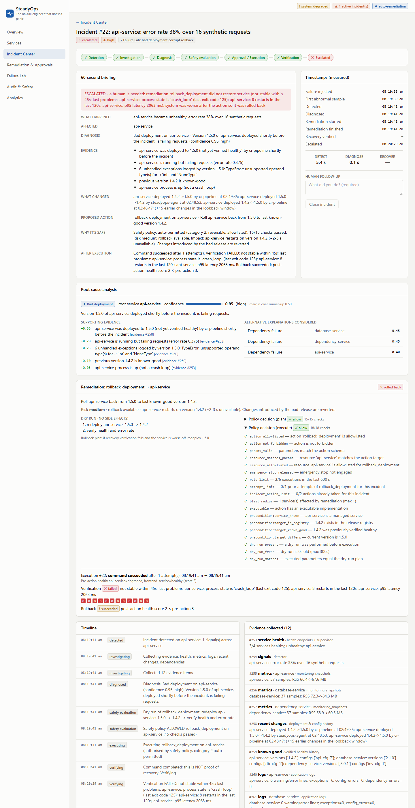

**Pending approval (supervised mode)**

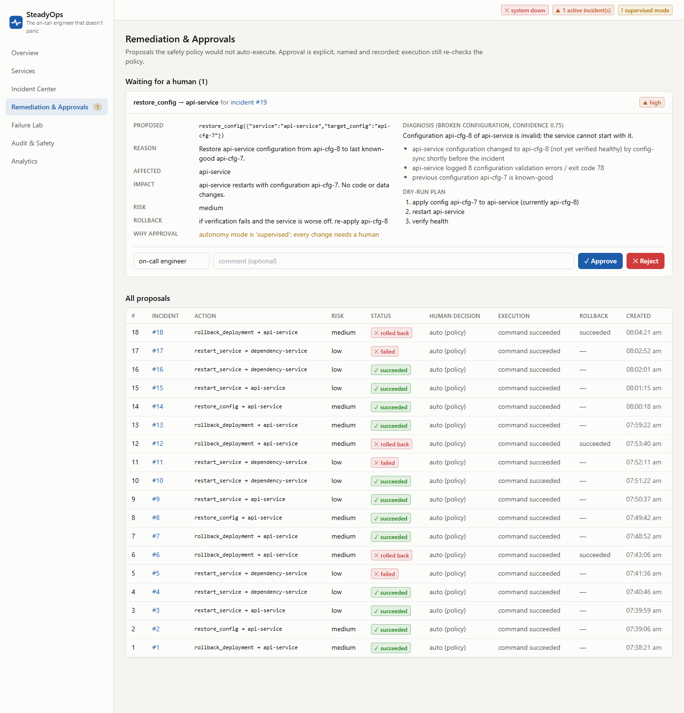

**Incident waiting for approval**

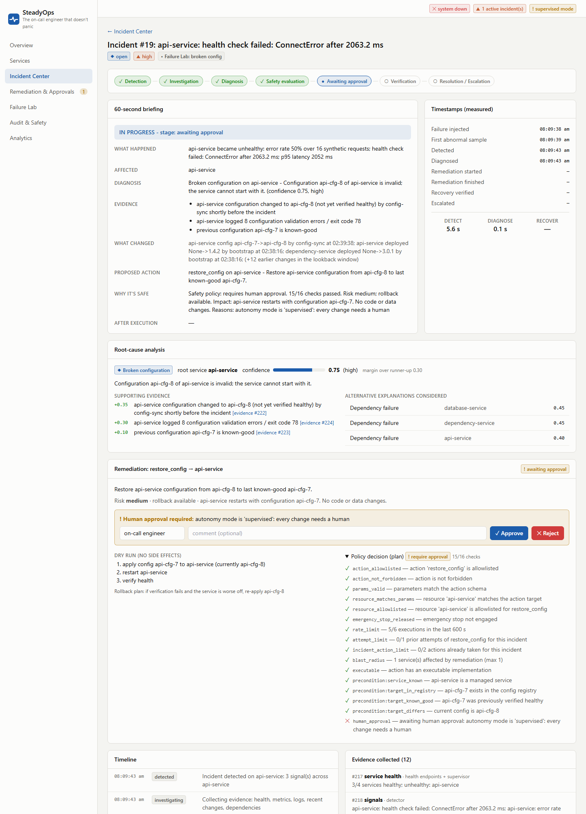

**Failure Lab**

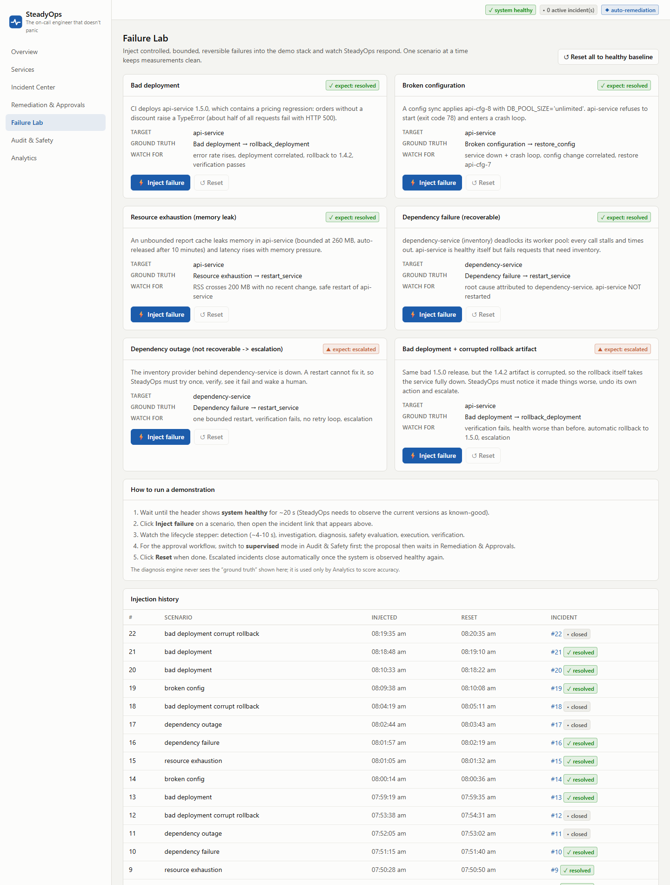

**Audit & Safety (policy simulator, blocked actions, audit log)**

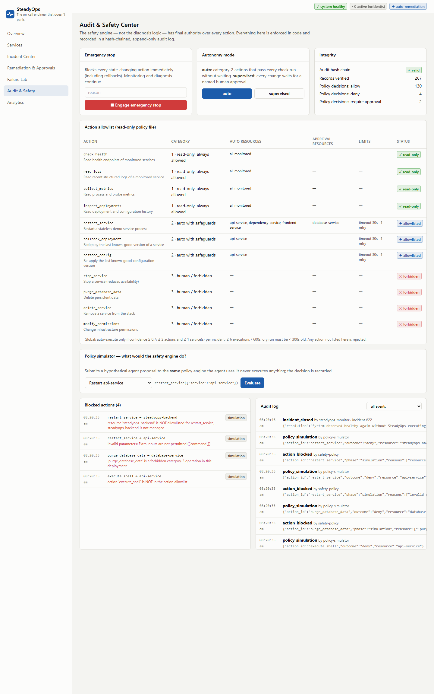

**Services**

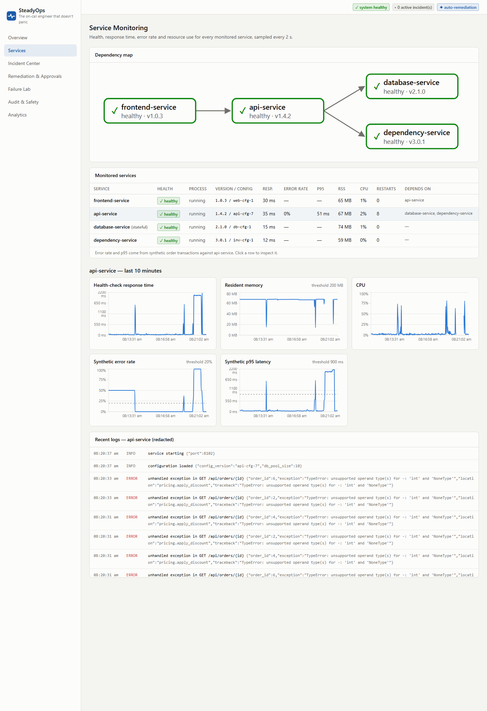

**Analytics**

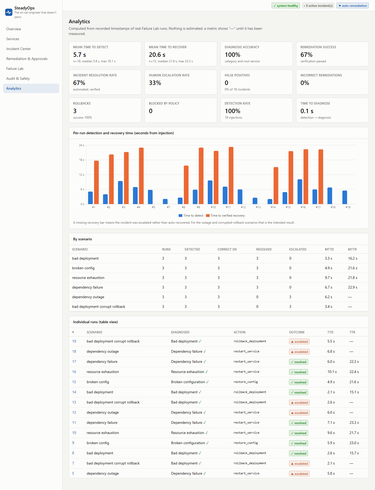

Overview and Analytics show the final evaluation database. The incident, approval, Failure Lab, Services and
Safety screenshots were captured during demonstration runs performed right after an evaluation,
using the same code; they show real incidents, not mock-ups.

Sample timeline (measured, bad deployment):
```
17:35:10 detected          Incident detected on api-service: 1 signal(s) across api-service
17:35:10 investigating     Collected 12 evidence items
17:35:10 diagnosed         Diagnosis: Bad deployment on api-service (confidence 0.95, high)
17:35:10 safety_evaluation Dry run of rollback_deployment: redeploy api-service: 1.5.0 -> 1.4.2 -> verify health and error rate
17:35:10 safety_evaluation Safety policy ALLOWED rollback_deployment on api-service (15 checks passed)
17:35:10 executing         Executing rollback_deployment on api-service (authorised by safety policy, category 2 auto-permitted)
17:35:10 verifying         Command completed; this is NOT proof of recovery. Verifying...
17:35:23 resolved          Recovered by rollback_deployment on api-service. Verified: 5 consecutive healthy observations over 8s
```

## 32. Limitations

1. Laptop-scale simulation; injected failures follow known patterns that the rules were designed alongside.
   Accuracy on these scenarios is not evidence of accuracy on unseen production failures.
2. Four failure categories; everything else becomes "ambiguous → escalate".
3. No authentication/RBAC; approvals are attributed to self-declared names.
4. Tamper-evident (not tamper-proof) audit log in a local SQLite file.
5. One incident at a time per stack; one execution at a time; single control-plane node.
6. Fixed thresholds rather than learned baselines; the latency in the leak scenario is simulated.
7. Docker Compose packaging was written but not executed (Docker was unavailable on the build machine).
8. Detection granularity is bounded by the 2 s sampling interval and 2-tick debounce, so MTTD cannot drop below ~2–4 s.

## 33. Future scope

- Kubernetes/cloud executors behind the same policy interface, using scoped service accounts.
- OIDC authentication, RBAC, and two-person approval for sensitive actions.
- Baseline/anomaly detection; OpenTelemetry/Prometheus ingestion; trace-based dependency discovery.
- An optional LLM used **only** to rephrase the redacted summary or suggest hypotheses for human
  review, with structured-output validation and no tool access. The policy engine stays the authority.
- Post-incident report generation, runbook-as-code, and ChatOps notifications.
- Shipping audit records to WORM storage or a transparency log.

## 34. Conclusion

SteadyOps shows that automated incident response does not need to trade safety for speed. Placing
a deterministic policy engine between the deciding components and a deliberately small execution
surface gives a system that recovers routine failures in seconds, refuses destructive and unknown
actions by construction, attributes failures to their root rather than their victims, verifies
before it declares success, undoes its own mistakes, and wakes a human when it cannot help. Its
measured results are reported alongside its limitations so they can be reproduced and challenged.

## 35. References

1. Beyer, B., Jones, C., Petoff, J., Murphy, N. R. (eds.), *Site Reliability Engineering: How Google Runs
   Production Systems*, O'Reilly, 2016. Chapters on monitoring, emergency response and effective
   troubleshooting informed the detection and escalation design.
2. FastAPI documentation, https://fastapi.tiangolo.com/
3. SQLite documentation: triggers, WAL mode, https://www.sqlite.org/docs.html
4. OWASP Top 10 for Large Language Model Applications (prompt injection, excessive agency),
   https://owasp.org/www-project-top-10-for-large-language-model-applications/
