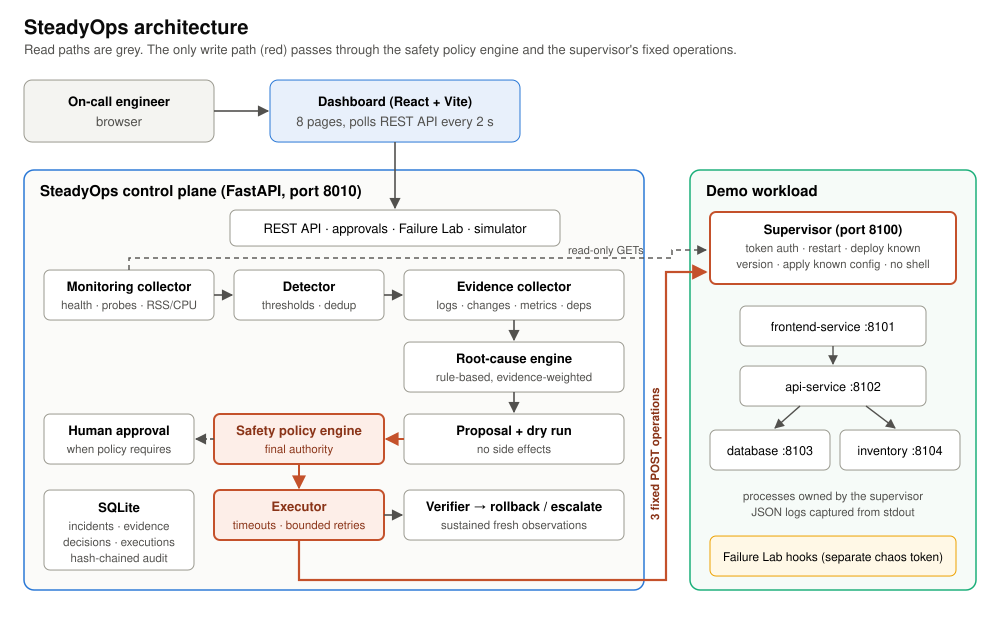
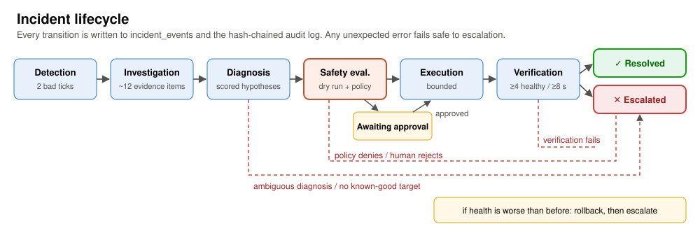

# SteadyOps Architecture



## 1. Components

| Component | Location | Responsibility | Privileges |
|---|---|---|---|
| Demo services | `demo-services/{frontend,api,database,dependency}-service/app.py` | The monitored workload. Emit JSON logs, expose `/health`. | none over anything else |
| Supervisor | `demo-services/supervisor/supervisor.py` | Owns the service processes; restart-on-failure with backoff; records the change history; enforces the release/config registry (`stack.json`) | can start/stop *its own* children only |
| Collector | `backend/app/monitoring/collector.py` | One observation per tick (2 s): supervisor state, health checks, 4 synthetic order transactions, change-history sync, known-good marking | read-only client |
| Detector | `backend/app/detection/detector.py` | Threshold signals → debouncing (2 ticks) → de-duplication → root attribution → incident | DB only |
| Evidence collector | `backend/app/investigation/evidence.py` | Stores 8 kinds of evidence per incident and builds the RCA context | read-only client |
| Root-cause engine | `backend/app/investigation/rca.py` | Pure function: weighted hypotheses → diagnosis + recommendation | none |
| Explainer | `backend/app/investigation/explain.py` | Deterministic plain-language summary | none |
| Action catalogue | `backend/app/remediation/actions.py` | Typed actions with schemas, preconditions, dry run, execute, rollback | — |
| Policy engine | `backend/app/safety/policy.py` | Final allow / require-approval / deny decision | DB only |
| Executor | `backend/app/remediation/executor.py` | The **only** holder of the operations client | 3 fixed operations |
| Verifier | `backend/app/verification/verifier.py` | Sustained fresh observations decide resolution | read-only |
| Orchestrator | `backend/app/orchestrator.py` | Monitor loop + incident pipeline + approval handling | — |
| Audit log | `backend/app/safety/audit.py` | Append-only, hash-chained audit records | DB only |
| Failure Lab | `backend/app/failure_lab.py` | Fault injection with ground truth for scoring | chaos client |
| REST API | `backend/app/api/routes.py` | Dashboard interface; no "execute" endpoint | — |
| Dashboard | `frontend/src` | 8 pages, polls the API | HTTP to the API only |

## 2. Service communication

```
browser ──HTTP──► SteadyOps API (8010) ──GET (token)──► supervisor (8100) /services /logs /changes /registry
                        │                 ──POST (token)─► supervisor: /services/{s}/restart|deploy|config   [executor only]
                        │                 ──POST (chaos)─► supervisor: /chaos/{scenario}, /chaos-reset      [Failure Lab only]
                        ├──GET /health──► each demo service (8101-8104)
                        └──GET /api/orders/{id}──► api-service (synthetic transactions)

frontend-service (8101) ──► api-service (8102) ──► database-service (8103)
                                                └─► dependency-service (8104)
```

Every hop is plain HTTP on `127.0.0.1` (or the Compose network). Tokens travel in headers and are
compared in constant time.

## 3. Data flow for one incident

1. **Observe**: the collector writes a `monitoring_snapshots` row per service and syncs
   deployments, config changes and runtime events from the supervisor's change history.
2. **Detect**: the detector computes signals (`service_down`, `crash_loop`, `health_check_failed`,
   `health_degraded`, `high_error_rate`, `high_latency`, `high_memory`, `high_cpu`). A service is
   abnormal once its signals persist for 2 consecutive ticks. If an incident is already open, new
   signals attach to it. Otherwise a new `incidents` row is created with `detected_service` set to
   the most upstream abnormal service.
3. **Investigate**: four category-1 reads are authorized by the policy engine and recorded. Eight
   kinds of evidence are stored in `evidence`.
4. **Diagnose**: `rca.diagnose()` returns category, root service, cause, confidence, supporting and
   contradicting factors (each linked to an evidence id), alternatives and a recommendation, stored in `diagnoses`.
5. **Propose and dry run**: the recommended action becomes a `remediation_proposals` row, and its side-effect-free plan
   is stored in `dry_runs` with a SHA-256 hash.
6. **Policy (plan phase)**: the outcome is stored in `policy_decisions`.
   - deny → proposal `blocked` → escalate.
   - require_approval → proposal `awaiting_approval` → stop; a human decides through the API.
   - allow → executor.
7. **Policy (execute phase)**: re-evaluated with the latest dry run, current state and approval.
8. **Execute**: pre-state captured; bounded attempts; `remediation_executions` row.
9. **Verify**: fresh observations until stable or timed out; `verifications` row.
10. **Outcome**: resolve; or compare health with the pre-state, roll back if worse (`rollbacks`), and escalate.

## 4. Incident lifecycle



| Status | Stage values | Who moves it |
|---|---|---|
| `open` | detected, investigating, diagnosed, safety_evaluation, awaiting_approval, executing, verifying | pipeline |
| `resolved` | resolved | verifier only |
| `escalated` | escalated | pipeline (ambiguity, denial, rejection, failed verification, internal error) |
| `closed` | closed | operator, or the monitor once an escalated/awaiting incident is observed healthy for 5 ticks |

## 5. Agent and safety-engine boundaries

The "agent" is everything that proposes: detector, evidence collector, RCA and orchestrator. It
has no way to change the system. The boundary is structural:

- `SupervisorOpsClient` (three methods) is constructed once and handed **only** to `Executor`.
- `Executor.run()` refuses proposals whose status is not `proposed` or `approved`, and it executes
  only after `PolicyEngine.evaluate(phase="execute")` returns `allow`.
- The policy file is loaded read-only at startup. No API modifies it.
- Settings that relax safety (autonomy mode, emergency stop) are written only by operator
  endpoints, and every change is audited.
- The supervisor independently re-validates every request against `stack.json`, so even a
  compromised control plane cannot deploy an unknown version or start an unknown process.

## 6. Key design decisions

| Decision | Reason |
|---|---|
| Supervisor API instead of Docker socket | The Docker socket is root-equivalent. A narrow HTTP API gives least privilege and works without Docker. |
| Rule-based RCA, no LLM dependency | Deterministic, testable and explainable; runs without paid keys; no prompt-injection surface. |
| Known-good learned from observation | Rollback targets must have been *seen* healthy for 20 s, not just be "the previous version". |
| Verify with fresh probes, not windows | Windowed metrics lag; verification must reflect the state after the action. |
| One incident at a time per stack, one execution at a time | Keeps blast radius and measurement clean in an MVP. |
| SQLite + WAL, stdlib only | Zero setup; enough for a laptop-scale control plane. |
