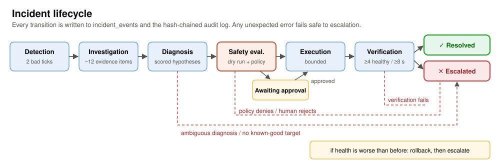
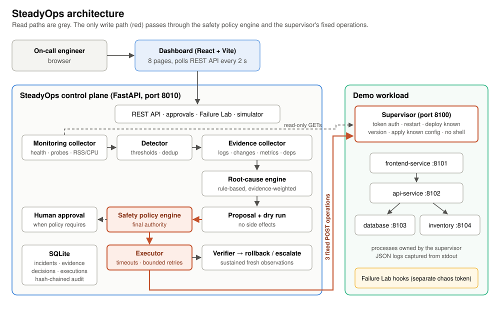
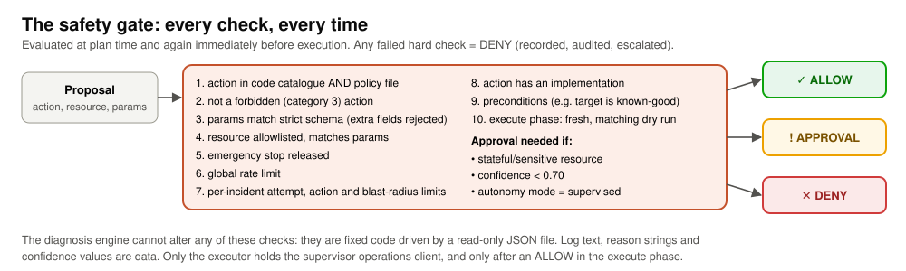
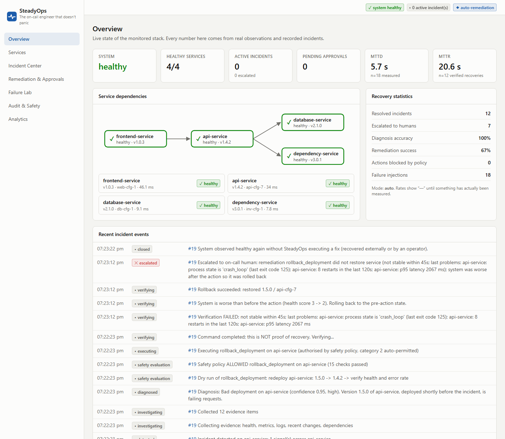
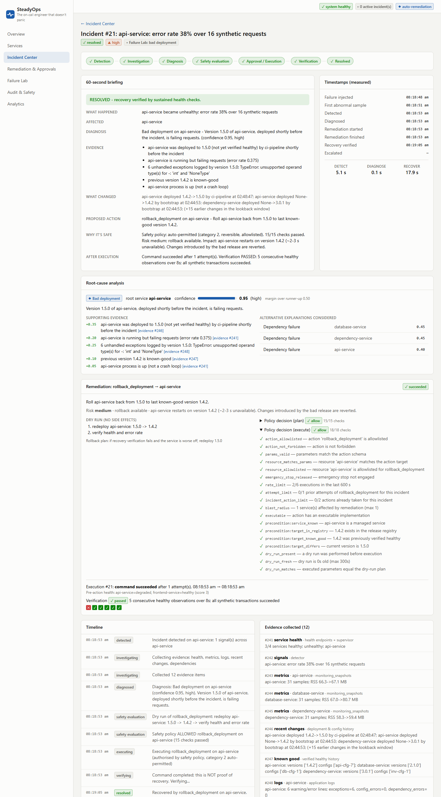
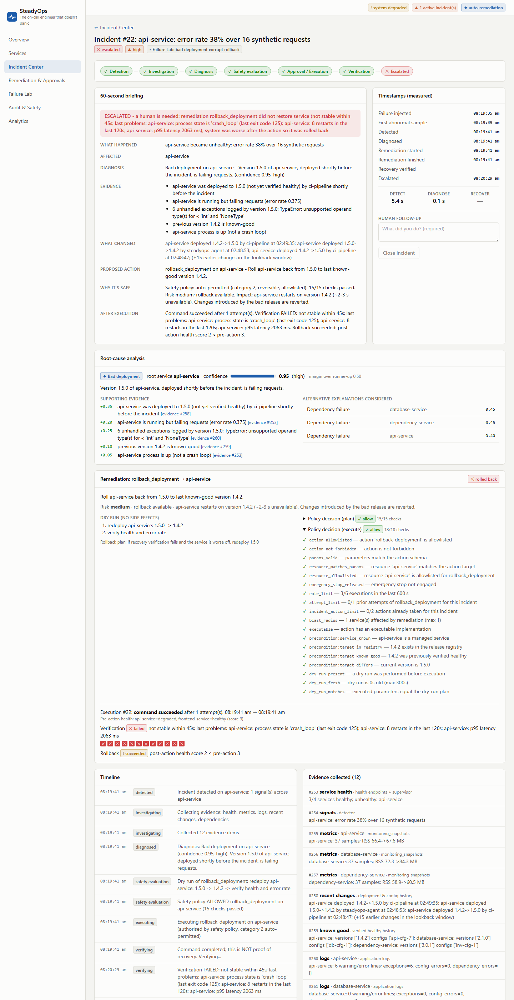
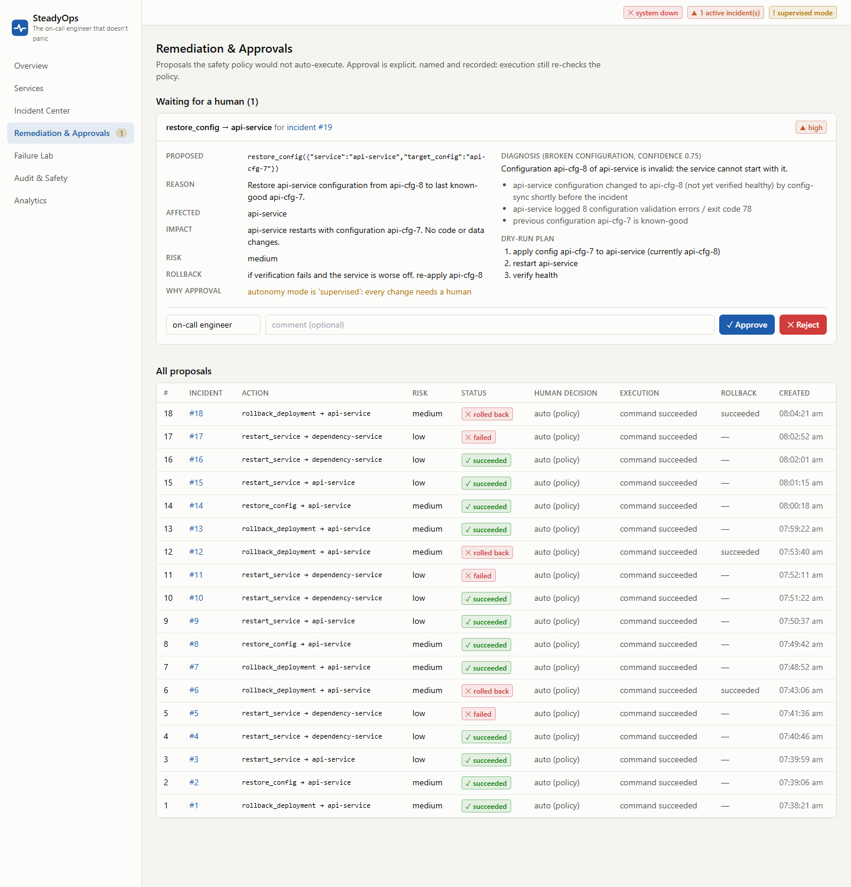
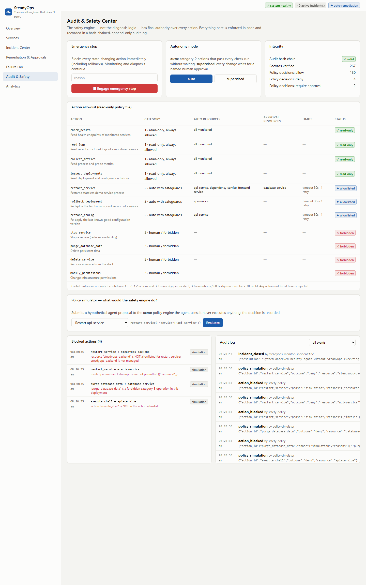
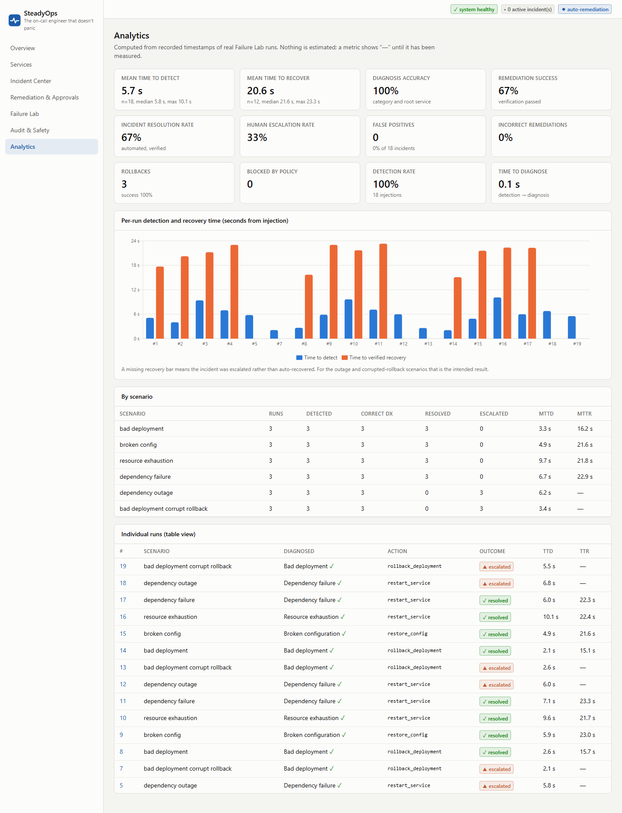

# SteadyOps — Project Report

## Table of contents
1. Project overview · 2. Problem statement · 3. Objectives · 4. Proposed methodology ·
5. Architecture · 6. Implementation · 7. Results · 8. Screenshots · 9. Testing · 10. Conclusion · 11. Future scope

---

## 1. Project overview

**SteadyOps** is a working incident-response and automated-recovery platform for cloud-native,
multi-service applications. It monitors a four-service demo system, detects failures, collects
evidence, diagnoses the root cause, and recovers automatically, but only through allowlisted,
bounded and reversible operations that an independent safety policy engine permits. Sensitive
actions require explicit human approval. Destructive actions are refused. Recovery is declared only
after sustained verification. If SteadyOps' own action makes things worse, it rolls the action back
and escalates to a human.

The project spans cloud computing (service health, deployments, configuration management), cloud
security (least privilege, allowlisting, audit integrity, secret handling) and MLOps/AIOps
(automated diagnosis and remediation with human-in-the-loop governance).

| Item | Summary |
|---|---|
| Deliverable | Full-stack MVP: demo workload, control plane, dashboard, tests, documentation |
| Stack | Python, FastAPI, Pydantic, SQLite, React, Vite, TypeScript, Tailwind CSS, Recharts |
| Runs on | A normal laptop; no paid APIs, cloud account or Kubernetes |
| Failure scenarios | 6 (4 failure categories + 2 escalation paths) |
| Tests | 64 backend unit/API/security tests, 2 real-process integration tests, 4 frontend tests |

## 2. Problem statement

When a production system fails, an engineer must examine alerts, logs, metrics, recent deployments,
configuration changes and service dependencies to find the root cause. This takes time, especially
for small teams without dedicated on-call engineers. AI agents can assist, but unrestricted
autonomous access to infrastructure is dangerous: one incorrect command can delete resources,
restart healthy services, expose credentials, cause data loss or worsen the outage.

The problem addressed is therefore: *how can incident investigation and routine recovery be
automated so that the automation can never make an incident catastrophically worse simply because it
is able to execute commands?*

## 3. Objectives

1. Detect controlled failures in a multi-service application within seconds, without false alarms.
2. Collect relevant, sourced evidence and identify the most likely root cause with an honest confidence.
3. Support at least three failure categories (four were implemented).
4. Recommend and execute recovery only through an allowlisted set of operations.
5. Enforce a safety policy with final authority: dry runs, allowlists, limits, approvals, emergency stop.
6. Verify recovery independently, roll back harmful actions, and escalate when recovery is not possible.
7. Keep a complete, tamper-evident audit trail and measure MTTD/MTTR from real timestamps.
8. Present everything in a dashboard that a tired engineer can understand in under a minute.

## 4. Proposed methodology

The methodology follows the incident lifecycle used in Site Reliability Engineering, with a safety
gate inserted between deciding and acting.



1. **Observe.** Sample health endpoints, synthetic user transactions, process metrics and the change
   history every 2 seconds.
2. **Detect.** Compare observations with configurable thresholds, require persistence over two
   samples, de-duplicate, and attribute the incident to the most upstream failing service.
3. **Investigate.** Collect eight categories of evidence, each stored with its source.
4. **Diagnose.** Score four hypotheses with weighted, evidence-linked factors. Report confidence and
   alternatives, and refuse to act on ambiguous results.
5. **Plan.** Convert the diagnosis into a typed proposal and produce a side-effect-free dry run.
6. **Gate.** The policy engine evaluates the proposal (allow / require approval / deny) at plan
   time and again immediately before execution.
7. **Act.** Execute the single permitted operation with a timeout and bounded retries.
8. **Verify.** Require sustained healthy observations and successful end-to-end transactions.
9. **Conclude.** Resolve; or roll back if the action made things worse, and escalate.

Evaluation uses controlled fault injection, where the ground truth is known for every run, so
detection time, recovery time and diagnosis accuracy can be measured objectively.

## 5. Architecture



The system has three tiers:

- **Demo workload.** frontend-service → api-service → database-service and dependency-service
  (inventory), run as processes owned by a **supervisor**. The supervisor's token-protected API
  offers read endpoints and only three operations: restart a known service, deploy a registered
  version, apply a registered configuration. It replaces Docker-socket access, which would be
  root-equivalent.
- **SteadyOps control plane.** Collector, detector, evidence collector, root-cause engine, policy
  engine, executor, verifier and orchestrator, with a SQLite store and a hash-chained audit log.
  Only the executor holds the client that can change the workload.
- **Dashboard.** Eight pages (Overview, Services, Incident Center, Incident Detail, Remediation &
  Approvals, Failure Lab, Audit & Safety, Analytics) showing live data from the REST API.



## 6. Implementation

### 6.1 Demo services and failure injection
Each failure is a real code path, triggered by the Failure Lab:

| Scenario | Implementation | Bounds |
|---|---|---|
| Bad deployment | api-service 1.5.0 drops a `None` guard in `apply_discount` → `TypeError` → HTTP 500 on ~50% of orders | reset redeploys 1.4.2 |
| Broken configuration | `DB_POOL_SIZE="unlimited"` fails startup validation → exit 78 → crash loop | reset restores config |
| Resource exhaustion | leak of 10 MB every 0.5 s, capped at 260 MB, self-releasing after 10 min; latency grows with memory | hard cap |
| Dependency failure | inventory worker pool hangs (4 s stall → 503) | restart clears |
| Dependency outage | as above, plus an upstream outage that persists across restarts | reset clears |
| Corrupted rollback | bad deploy plus a corrupt 1.4.2 artifact (start fails, exit 125) | reset clears |

The supervisor's change history records deployments, config changes, restarts and exits, which a real
platform would also log, but never the fault injections themselves. Diagnosis cannot "cheat".

### 6.2 Detection
Eight signal types (service down, crash loop, health check failed/degraded, high error rate, high
latency, high memory, high CPU). Windowed metrics also require a failure in the current sample. This
rule was added after a test showed that a single bad sample could linger in the window and open a
false-positive incident.

### 6.3 Root-cause analysis
A pure, deterministic function scores each hypothesis per candidate service. Example from a real run:

```
Bad deployment on api-service, confidence 0.95 (high)
 +0.35 deployed to 1.5.0 (not yet verified healthy) by ci-pipeline shortly before the incident
 +0.20 running but failing requests (error rate 0.375)
 +0.25 6 unhandled exceptions logged by version 1.5.0: TypeError ...
 +0.10 previous version 1.4.2 is known-good
 +0.05 process is up (not a crash loop)
```

A diagnosis with a top score below 0.5, or within 0.15 of the runner-up, is reported as ambiguous
and escalated.

### 6.4 Safety policy
All fourteen required controls are implemented: dry run, action allowlist, resource allowlist, least
privilege, timeouts, retry limits, rate limit, blast-radius limit, preconditions, post-action
verification, rollback, human approval, append-only audit and emergency stop. Actions fall into three
categories: read-only (always allowed), safeguarded (auto-allowed only when every check passes), and
sensitive/destructive (approval required or forbidden).

### 6.5 Approval, verification and rollback
Approvals are named and recorded. On approval, a fresh dry run must match the plan that was shown
(hash comparison). Verification requires at least 4 consecutive healthy fresh observations over at
least 8 s, with all synthetic transactions succeeding. If verification fails and the health score fell,
the executor rolls back to the pre-action state, then escalates.

### 6.6 Dashboard
React + TypeScript. Status is always conveyed with an icon and a word, never colour alone. Charts use
a validated, colour-vision-deficiency-safe palette with separate light and dark modes. Every value
comes from the API, and missing measurements show "—".

## 7. Results

Results from 18 controlled failure injections (six scenarios, 3 rounds each, fresh database).
All values are computed from recorded timestamps by `scripts/run_evaluation.py`.

| Metric | Measured value |
|---|---|
| Controlled failure injections | 18 (3 rounds × 6 scenarios) |
| Incidents recorded | 18 |
| Detection rate | 100% |
| **MTTD** (injection → detection) | 5.7 s (median 5.8 s, min 2.1 s, max 10.1 s, n=18) |
| **MTTR** (injection → verified recovery, recoverable runs) | 20.6 s (median 21.6 s, min 15.1 s, max 23.3 s, n=12) |
| Detection → verified recovery | 14.4 s (median 14.6 s, min 11.8 s, max 17.1 s, n=12) |
| Detection → diagnosis | 0.1 s (median 0.1 s, min 0.0 s, max 0.1 s, n=18) |
| Diagnosis accuracy (category **and** root service) | 100% |
| Runs ending in the *expected* outcome (resolve vs. escalate) | 18/18 |
| Remediation success rate (verification passed) | 67% |
| Incorrect-remediation rate | 0% |
| Incident resolution rate (automated) | 67% |
| False-positive incidents | 0 (0%) |
| Human escalation rate | 33% (all from the two escalation scenarios) |
| Rollbacks executed / success rate | 3 / 100% |
| Actions blocked by the safety policy (this run) | 0 |
| Excluded runs | 1 |
| Audit hash chain after evaluation | valid (222 records) |

| Scenario | Runs | Detected | Correct diagnosis | Resolved | Escalated | MTTD | MTTR |
|---|---|---|---|---|---|---|---|
| bad_deployment | 3 | 3 | 3 | 3 | 0 | 3.3 s | 16.2 s |
| broken_config | 3 | 3 | 3 | 3 | 0 | 4.9 s | 21.6 s |
| resource_exhaustion | 3 | 3 | 3 | 3 | 0 | 9.7 s | 21.8 s |
| dependency_failure | 3 | 3 | 3 | 3 | 0 | 6.7 s | 22.9 s |
| dependency_outage | 3 | 3 | 3 | 0 | 3 | 6.2 s | n/a |
| bad_deployment_corrupt_rollback | 3 | 3 | 3 | 0 | 3 | 3.4 s | n/a |

**Interpretation.**

- All 18 injected failures were detected; there were 0 false-positive incidents.
- Every diagnosis named the correct category and root service (100%). For the dependency
  scenarios this means the incident was attributed to `dependency-service`, and the healthy-but-affected
  `api-service` was never restarted.
- The 12 recoverable runs were all recovered automatically and verified. MTTR averaged 20.6 s;
  roughly 8–10 s of that is the deliberate stabilisation window the verifier requires before declaring recovery.
- The 6 escalations are the two scenarios designed to be unrecoverable. In `dependency_outage` exactly one
  bounded restart was attempted before escalating. In `bad_deployment_corrupt_rollback` the rollback itself crash-looped,
  SteadyOps detected that health had dropped, rolled back to the pre-action version (rollbacks: 3, success 100%),
  then escalated. Their verification failures account for the remediation success rate of 67%.
- Resource exhaustion has the slowest detection (9.7 s) because the leak
  must grow past the 200 MB threshold; bad deployments are fastest (the error rate crosses 20% within ~2 samples).
- Detection → diagnosis takes about 0.1 s: rule-based RCA over stored evidence is effectively instantaneous.

**Evaluation history (all attempts, kept for transparency).**

1. *Unpaced harness.* The first attempt injected faster than the policy's global rate limit (6 executions / 600 s).
   Runs 7–10 were diagnosed correctly, but the safety policy denied execution (`6/6 executions in the last 600 s`)
   and escalated them. This is the control working as designed. The harness was changed to wait for the window;
   the policy was not loosened. Records: `reports/rate_limit_observation_*`.
2. *Host suspend.* The second attempt ran overnight. The laptop suspended right after one injection and resumed 7 h 20 min
   later, so that run's timings were meaningless. The attempt was discarded, the harness gained wall-clock-jump
   detection (affected runs are excluded with an audited reason and repeated), and it now keeps Windows awake
   only while it runs.
3. *Clean run on the previous code.* 18 injections, detection rate 100%, diagnosis accuracy 100%, 0 false positives,
   MTTD 5.6 s, MTTR 21.0 s. Afterwards a back-to-back demo exposed defect #5
   (stale logs from a fixed incident lowering the next diagnosis), which was fixed.
4. *Final run on the final code* (fresh database): the results reported above. The laptop suspended
   during this attempt too (run #6). The harness detected the clock jump, excluded that run with an audited
   reason (see *Excluded runs*), and the evaluation was completed with `--resume`, which keeps the valid
   runs already recorded and runs only the missing ones.

## 8. Screenshots

**Overview** (live system state and measured statistics)


**Incident detail** (resolved bad deployment: lifecycle, 60-second briefing, diagnosis, policy checks, verification)


**Incident detail** (corrupted rollback: verification failed, automatic rollback, escalation)


**Remediation & Approvals** (supervised mode: proposal waiting for a human)


**Audit & Safety** (emergency stop, autonomy mode, allowlist, policy simulator, blocked actions, audit log)


**Analytics** (measured detection and recovery times per run)


## 9. Testing

| Suite | Count | Result |
|---|---|---|
| Detection (no false incidents, debounce, de-dup, transient blips, root attribution, blind supervisor) | 8 | passed |
| Root-cause analysis (4 categories, evidence links, ambiguity, no known-good, log injection, stale-log regression) | 10 | passed |
| Safety policy (read-only, category 2, approval, forbidden, unknown, invalid resource, smuggled params, retries, blast radius, rate limit, emergency stop, supervised, dry-run freshness, audit of denials) | 15 | passed |
| Remediation (dry run has no side effects, each scenario end-to-end, failed verification, rollback, bounded retries, emergency stop, approval, rejection, no double approval, recovery time, rollback metrics) | 14 | passed |
| Security (redaction, secrets never stored, audit tamper evidence, no shell primitives, ops-client surface, input validation, no execute route, private notes ignored, `.env` ignored) | 10 | passed |
| API (overview, full flow, validation, simulator never executes, emergency stop, log redaction, run exclusion) | 7 | passed |
| Integration with real processes (bad deployment, dependency failure) | 2 | passed |
| Frontend (format and lifecycle helpers; strict TypeScript build) | 4 | passed |

Six defects were found and fixed, each with a regression test: two false-positive paths from
lingering windowed metrics; a secret copied into diagnosis text before redaction; superseded
deployments implicating later incidents; logs from an already-fixed incident lowering the confidence
of the next diagnosis (found in a back-to-back live demo; SteadyOps responded safely by requesting
approval); and an analytics query (`NOT IN (NULL)`) that silently zeroed two metrics, which was caught by
cross-checking the report against the raw database. The evaluation process also showed the global rate
limit (6 executions per 10 minutes) blocking an unpaced harness. The harness was changed to respect the
policy, not the other way round. A run invalidated by a host suspend led to automatic detection and
audited exclusion of such runs.

## 10. Conclusion

SteadyOps demonstrates that automated incident response can be both fast and safe when safety is
built into the architecture rather than delegated to the agent's judgement. The diagnosing
components can only propose, an independent policy engine decides, and a single executor performs
one of three typed operations. With this separation, the system recovered every recoverable injected
failure automatically and verifiably, attributed dependency failures to the dependency rather than
its victims, escalated unrecoverable situations after a single bounded attempt, and undid its own
action when that action made the system worse. The results are reported together with the
limitations of a laptop-scale simulation.

## 11. Future scope

- Executors for Kubernetes and cloud APIs behind the same policy interface, with scoped credentials.
- Authentication (OIDC), role-based approvals and a two-person rule for sensitive actions.
- Statistical baselines and anomaly detection instead of fixed thresholds; OpenTelemetry ingestion.
- An optional language model restricted to explaining the already-redacted structured summary.
- External write-once audit storage; automatic post-incident reports; ChatOps notifications.
